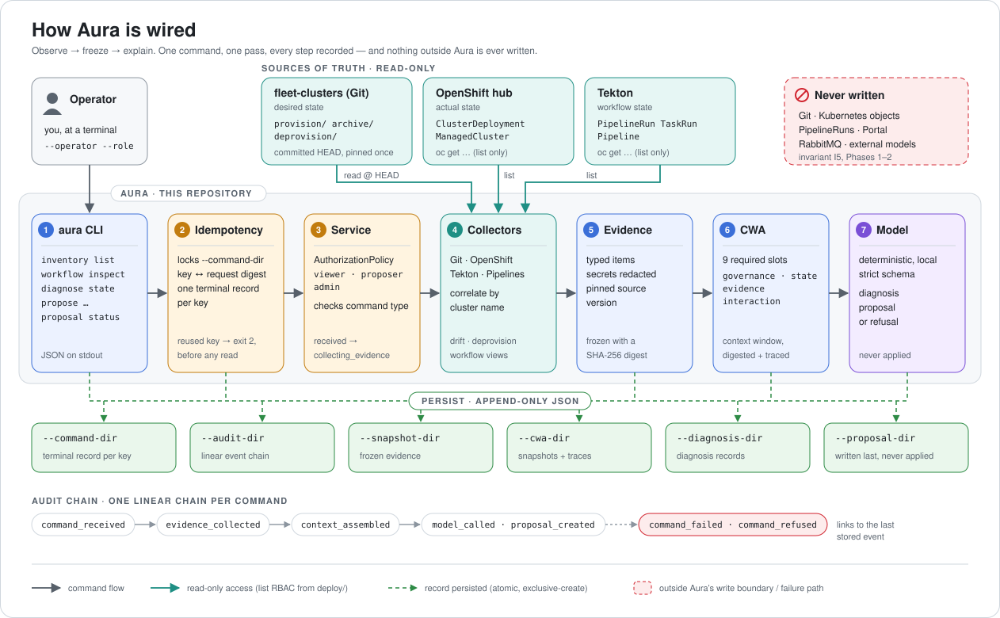
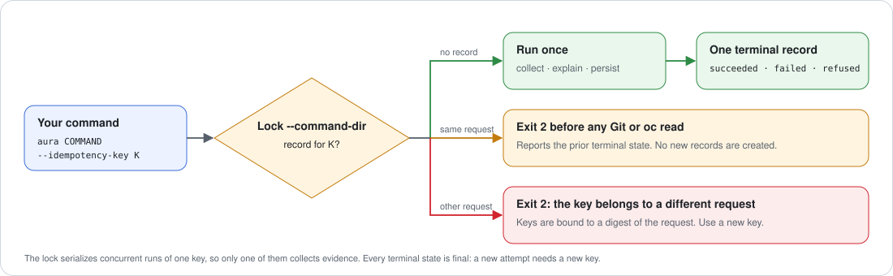

<div align="center">

# Aura

Aura is a command-line control plane for OpenShift Partner Labs operators: it reads `fleet-clusters` Git, the OpenShift hub, and Tekton, explains each cluster's state, and stores reviewable change proposals.

[](https://github.com/redhat-openshift-partner-labs/aura/actions/workflows/ci.yml)
[](LICENSE)


[Quickstart](#quickstart) ·
[Install](#install-for-live-clusters) ·
[How it works](#how-it-works) ·
[Commands](#commands-at-a-glance) ·
[Idempotency](#idempotency-explained) ·
[Docs](#documentation-map) ·
[Contributing](#contributing) ·
[License](#license)

</div>

---

## Why Aura?

A Partner Labs cluster has its **desired state** in `fleet-clusters` Git, its **actual state** on the OpenShift hub, and its **workflow history** in Tekton. When they disagree, an operator has to compare the three sources by hand while any of them may change.

Aura reads all three sources, freezes what it read into a digest-stamped [evidence snapshot](docs/evidence.md#evidence-snapshot), correlates everything by cluster name, and reports the result as typed JSON.

Aura is a **sidecar**. Git, OpenShift, Tekton, ACM/Hive, RabbitMQ, and Portal stay authoritative; Aura [never writes to any of them](docs/architecture.md#read-only-boundary).

| | What you get |
| --- | --- |
| 🔭 **See** | [Cluster inventory](docs/cli.md#inventory-list) and [workflow views](docs/cli.md#workflow-inspect) that flag real [drift](docs/evidence.md#cluster-inventory-fields), incomplete definitions, and stranded deprovisions |
| 🧭 **Explain** | A deterministic [diagnosis](docs/cli.md#diagnose-state) of one cluster, citing the evidence behind every claim, or an explicit [refusal](docs/architecture.md#refusal) when evidence is missing |
| 📝 **Propose** | Reviewable [proposals](docs/evidence.md#proposal) for new-cluster scaffolds, deprovisions, `metadata.yaml` backfills, and post-provision reruns, stored for a human and never applied |
| 🧾 **Prove** | Append-only records and a linear [audit chain](docs/wiring.md#audit-chain) that link every answer back to the exact evidence it came from |

---

## How it works

<p align="center">
  
</p>

Every command makes one pass through the same pipeline. The numbers match the diagram.

1. **CLI** – [`aura`](docs/cli.md) parses flags, checks flag combinations, and wires the right collector for the command.
2. **Idempotency gate** – the CLI locks `--command-dir` and checks your [idempotency key](#idempotency-explained) before anything is read.
3. **Service** – an `EvidenceCommandService` enforces the [authorization policy](docs/cli.md#common-flags) and the command type, then moves the command through its [lifecycle states](docs/wiring.md#command-routes).
4. **Collectors** – [Git, OpenShift, and Tekton collectors](docs/wiring.md#collector-wiring) read with list-only access and correlate by cluster name; Phase 3 also gets two policy ConfigMaps by name. Git is pinned to one resolved `HEAD`, so uncommitted work is never treated as desired state.
5. **Evidence** – results become a typed, [redacted](docs/security.md#secret-redaction), SHA-256-digested [`EvidenceSnapshot`](docs/evidence.md#evidence-snapshot).
6. **CWA** – the [Context Window Architecture](docs/evidence.md#cwa-snapshot) assembler freezes model input into nine required slots and records a [trace](docs/evidence.md#cwa-trace).
7. **Model** – a deterministic, local model or [proposal generator](docs/wiring.md#deprovision-proposals) returns strict, schema-validated output. No external model is wired, and model output is never treated as authorization.

Each stage persists [append-only JSON records](docs/wiring.md#record-wiring): atomic, `fsync`'d, exclusive-create, and never overwritten. For the full design, read [Architecture](docs/architecture.md) and [Wiring](docs/wiring.md).

---

## Quickstart

No cluster is required. You need [Python 3.12+](https://www.python.org/downloads/), [`uv`](https://docs.astral.sh/uv/), and `git`. Steps 1 and 2 work for anyone. Steps 3 and 4 also need a local checkout of `redhat-openshift-partner-labs/fleet-clusters` next to this repository; that repository is private, so without access, stop after step 2.

**1. Clone and install**

```bash
git clone https://github.com/redhat-openshift-partner-labs/aura.git
```

```bash
cd aura && uv sync
```

**2. Run the test suite** – it uses fake clients and temporary Git trees, so it needs no cluster or network.

```bash
uv run --no-sync pytest
```

**3. Run your first command** against a local `fleet-clusters` checkout. This one reads Git only.

```bash
uv run --no-sync aura inventory list \
  --source git \
  --fleet-clusters ../fleet-clusters \
  --operator you@example.com \
  --idempotency-key quickstart-001 \
  --command-dir ./local/commands
```

You get JSON on standard output: one evidence item per cluster definition and deprovision sentinel. See [Git inventory](docs/cli.md#git-inventory) for the item kinds.

**4. Run the exact same command again.** It exits `2` with `aura: idempotency key already succeeded` and reads nothing; see [Idempotency](#idempotency-explained). Use `quickstart-002` to run it again.

> [!TIP]
> `./local/` is ignored by Git, which makes it a safe home for your records. Commands in [`docs/`](docs) prefix `uv` with `UV_CACHE_DIR=/private/tmp/aura-uv-cache` to use a scratch cache; it is optional when you run Aura yourself.

---

## Install for live clusters

Reading OpenShift and Tekton needs this setup, once per hub.

### Prerequisites

| Requirement | Why |
| --- | --- |
| Python 3.12+ and [`uv`](https://docs.astral.sh/uv/) | Runs Aura and its locked dependencies |
| `git` and a local `fleet-clusters` checkout | Source of desired state; Aura reads its committed `HEAD` |
| `oc` | Reads `ClusterDeployment`, `ManagedCluster`, `PipelineRun`, `TaskRun`, and `Pipeline` resources |
| A kubeconfig for the `aura:aura-readonly` service account | Keeps Aura's access read-only and away from admin credentials |

### 1. Grant read-only RBAC on the hub

A cluster administrator applies the manifests in [`deploy/`](deploy). They grant `list` and nothing else; see [Minimum RBAC](docs/security.md#minimum-rbac). Preview first:

```bash
oc apply -k deploy --dry-run=server
```

```bash
oc apply -k deploy
```

### 2. Build an isolated kubeconfig

Create a kubeconfig that contains only the `aura-readonly` service account, for example at `$HOME/.kube/aura-readonly`. Follow the [kubeconfig rules](docs/security.md#service-account): never copy an administrator kubeconfig, never commit it, and keep its permissions private to you.

### 3. Verify access

Every line below must print `yes`; write verbs such as `create`, `patch`, and `delete` must print `no`.

```bash
oc --kubeconfig "$HOME/.kube/aura-readonly" auth can-i list clusterdeployments.hive.openshift.io -A
```

```bash
oc --kubeconfig "$HOME/.kube/aura-readonly" auth can-i list managedclusters.cluster.open-cluster-management.io
```

```bash
oc --kubeconfig "$HOME/.kube/aura-readonly" auth can-i list pipelineruns.tekton.dev -A
```

```bash
oc --kubeconfig "$HOME/.kube/aura-readonly" auth can-i list taskruns.tekton.dev -A
```

```bash
oc --kubeconfig "$HOME/.kube/aura-readonly" auth can-i list pipelines.tekton.dev -n openshift-pipelines
```

### 4. See the whole picture

The combined inventory joins Git, OpenShift, and Tekton into one `cluster_inventory` item per cluster, with a [drift indicator](docs/evidence.md#cluster-inventory-fields).

```bash
uv run --no-sync aura inventory list \
  --source combined \
  --fleet-clusters ../fleet-clusters \
  --openshift-kubeconfig "$HOME/.kube/aura-readonly" \
  --operator you@example.com \
  --idempotency-key combined-001 \
  --command-dir ./local/commands
```

Then diagnose one cluster, keeping every record:

```bash
uv run --no-sync aura diagnose state \
  --cluster <cluster-name> \
  --fleet-clusters ../fleet-clusters \
  --openshift-kubeconfig "$HOME/.kube/aura-readonly" \
  --snapshot-dir ./local/snapshots \
  --audit-dir ./local/audit \
  --cwa-dir ./local/cwa \
  --diagnosis-dir ./local/diagnoses \
  --operator you@example.com \
  --idempotency-key diagnose-001 \
  --command-dir ./local/commands
```

---

## Commands at a glance

Every command takes `--operator`, `--idempotency-key`, and `--command-dir`, and prints JSON. The [CLI reference](docs/cli.md) lists every flag, default, and dependency rule.

| Command | Answers | Role |
| --- | --- | --- |
| [`inventory list`](docs/cli.md#inventory-list) | Which clusters exist, and do Git and OpenShift agree? | `viewer` |
| [`workflow inspect`](docs/cli.md#workflow-inspect) | Which PipelineRuns ran, for which cluster, and where did they fail? | `viewer` |
| [`diagnose state`](docs/cli.md#diagnose-state) | Why is this one cluster in this state? | `viewer` |
| [`propose deprovision`](docs/cli.md#propose-deprovision) | What standalone commit would archive this cluster? | `proposer` |
| [`propose cluster-edit`](docs/cli.md#propose-cluster-edit) | Which `metadata.yaml` keys is this definition missing? | `proposer` |
| [`propose post-provision-rerun`](docs/cli.md#propose-post-provision-rerun) | What PipelineRun would rerun post-provision for this cluster? | `proposer` |
| [`propose scaffold`](docs/cli.md#propose-scaffold) | What definition would a pinned scaffold generate for a new cluster? | `proposer` |
| [`proposal status`](docs/cli.md#proposal-status) | Is a stored proposal stale against `fleet-clusters` `HEAD`? | `viewer` |

Phase 3 adds [`proposal submit`](docs/cli.md#proposal-submit), [`proposal approve` and `proposal reject`](docs/cli.md#proposal-approve-and-proposal-reject), and [`execute`](docs/cli.md#execute), which keep their records in the execution store and take the signer's identity from Aura's configuration file.

`admin` can run every command. `proposal status` also accepts `proposer`. When you pass no `--role`, Aura uses `viewer`; any `--role` you pass replaces that default.

> [!IMPORTANT]
> `--operator` and `--role` are **self-asserted**. They are recorded for audit, not authenticated, so a stored proposal does not prove its author holds `proposer`. See [Operator Identity](docs/security.md#operator-identity).

### Exit codes

| Code | Meaning |
| --- | --- |
| `0` | Success, including a proposal that is merely stale |
| `2` | Argument error, unauthorized role, refusal, failed write, duplicate record, reused idempotency key, or an error a command does not handle, reported as `internal error` or `filesystem error` |
| Other non-zero | An error raised before the idempotency check that Aura does not handle; this is a bug ([invariant I7](docs/development.md#project-invariants)) |

A refusal still stores its evidence, CWA, and audit records, so you can see exactly what was missing. See [Output and Exit Codes](docs/cli.md#output-and-exit-codes).

---

## Idempotency, explained

An idempotency key identifies one request. Aura stores one terminal record per key, so a retry, a repeated command, or two concurrent runs with the same key collect evidence at most once.

<p align="center">
  
</p>

| Rule | What it means for you |
| --- | --- |
| One key, one request | The key is bound to a digest of the request. Reusing it with different flags is rejected. |
| Terminal means final | `succeeded`, `failed`, and `refused` are all terminal. To try again, use a new key. |
| Checked before reading | A reused key exits `2` before any Git or `oc` call and creates no new records. |
| Safe under races | Concurrent uses of one key are serialized by the command store lock; only one run collects evidence. |
| Written once | A command that passes validation stores exactly one terminal record ([invariant I1](docs/development.md#project-invariants)). |

**Naming tip:** make keys readable and unique per request, for example `inventory-2026-10-25-01` or `diagnose-<cluster-name>-02`. Details live in [Common Flags](docs/cli.md#common-flags), [Record Wiring](docs/wiring.md#record-wiring), and the [Failure Model](docs/architecture.md#failure-model).

---

## Safety model

- **Read-only.** Collectors only list resources and read committed Git. Aura writes nothing to Git, Kubernetes, pipelines, Portal, or RabbitMQ ([invariant I5](docs/development.md#project-invariants)). Phase 3 adds guarded execution of approved proposals: the Tekton adapter creates one approved post-provision PipelineRun after the guard passes, and has not yet run against a hub.
- **Least privilege.** The [`deploy/`](deploy) manifests grant `list` only, plus `get` on two Phase 3 policy ConfigMaps by name, and [`tests/test_deploy_manifests.py`](tests/test_deploy_manifests.py) fails the suite if a collector reads a resource they do not grant. The staging PostgreSQL for Phase 3 is a separate kustomization in [`deploy/postgresql/`](deploy/postgresql); see [Staging Database](docs/security.md#staging-database). The Tekton adapter's `aura-executor` identity, with `create` and `get` on PipelineRuns in `openshift-pipelines` only, is another, in [`deploy/executor/`](deploy/executor).
- **No secrets at rest.** Secret-named fields are [redacted](docs/security.md#secret-redaction) across case and separator spellings before anything is stored, and an unhandled error stores only its type.
- **Refusal on missing evidence.** Missing, incomplete, invalid, or conflicting evidence produces a structured [refusal](docs/architecture.md#refusal).
- **Proposals are drafts.** Aura stores proposals and never applies, commits, or pushes them. A human reviews and merges.
- **No external model.** Diagnosis is deterministic and local; cluster evidence never leaves your machine. See [Model Boundary](docs/security.md#model-boundary).

> [!WARNING]
> Never modify the protected repositories `fleet`, `fleet-cluster-scaffold`, `fleet-clusters`, or `portal` from this project. Aura reads `fleet-clusters` and OpenShift only.

**Not implemented:** applying patches, creating commits or pull requests, running pipelines, and deprovisioning, which Phase 3 adds only after explicit approval. **Out of scope:** writing Portal data, replacing RabbitMQ, autonomous execution, and running as a long-lived service or web UI.

---

## Project status

| Phase | Scope | State |
| --- | --- | --- |
| [Phase 1](docs/plans/04-phase-1-read-only-assistant.md) | Read-only inventory, workflow inspection, and diagnosis | ✅ Shipped and validated |
| [Phase 2](docs/plans/05-phase-2-proposals.md) | Deterministic proposals, never applied | ✅ Closed: scaffold, deprovision, cluster-edit, and rerun proposals validated; signed off 2026-10-26 |
| [Phase 3](docs/plans/06-phase-3-approved-execution.md) | Guarded execution after explicit human approval | 🚧 Stages 1–3 done: hardening, the execution store, signed approvals, the guard and `execute` dry run; Stage 4, the Tekton adapter, next |

Current numbers, validation runs, and remaining gaps live in [Implementation Status](docs/status.md).

---

## Contributing

You do not need cluster access to contribute: the test suite runs on fakes and temporary Git trees.

### The workflow

The [Development Workflow](docs/development.md) explains why each step exists; in short:

1. **Read the spec** in [`docs/plans/`](docs/plans) and the contract docs. If behavior is unspecified, ask.
2. **Write a test plan first**, covering behavior, contract negatives, [failure modes](docs/development.md#failure-mode-matrix), [invariants](docs/development.md#project-invariants), and [input edges](docs/development.md#input-edge-checklist).
3. **Write failing tests**, and confirm each fails for the right reason.
4. **Make the smallest correct change**, matching the surrounding style.
5. **Verify** with the commands below.
6. **Update the docs** your change affects, in the same commit series.
7. **Commit** with a [Conventional Commit](https://www.conventionalcommits.org/) and sign-off.
8. **Get an independent review**, and fix confirmed findings test-first.

### Before you open a pull request

```bash
uv run --no-sync pytest
```

```bash
git diff --check
```

```bash
git commit -s -m "feat(inventory): classify archived clusters"
```

The project also runs a structural [quality gate](docs/development.md#5-verify) and the [CI workflow locally with `act`](docs/development.md#9-run-the-ci-workflow-locally); both are described in the workflow.

### Good places to start

| You want to… | Start here |
| --- | --- |
| Add a new inventory source | Implement `EvidenceCollector` and wire it in the CLI |
| Add a read-only command | Add a `CommandType`, service spec, collector, parser, and tests |
| Add a proposal type | Write a generator that turns a `CWASnapshot` into a `Proposal` |
| Improve the docs | Any page in [`docs/`](docs); README diagrams are SVG files in [`docs/assets/`](docs/assets) |

The full list of seams is in [Extension Points](docs/wiring.md#extension-points). AI coding agents follow [`AGENTS.md`](AGENTS.md); Claude also reads [`CLAUDE.md`](CLAUDE.md).

---

## Documentation map

| | Document | Read it when you want to… |
| --- | --- | --- |
| **Use** | [CLI Reference](docs/cli.md) | Look up a flag, default, or exit code |
| | [Security and Access](docs/security.md) | Set up RBAC, the kubeconfig, redaction, and the staging database |
| | [Validation](docs/validation.md) | Run fixture or live validation and compare results |
| **Understand** | [Architecture](docs/architecture.md) | See the boundaries, layers, and failure model |
| | [Wiring](docs/wiring.md) | Trace a command through services, collectors, and stores |
| | [Evidence](docs/evidence.md) | Read evidence, CWA, audit, diagnosis, and proposal records |
| | [Status](docs/status.md) | Check what is implemented and what is next |
| | [Plans](docs/plans/readme.md) | Read the phased design and open questions |
| **Contribute** | [Development Workflow](docs/development.md) | Make a change the way the project expects |
| | [`AGENTS.md`](AGENTS.md) | Configure an AI agent for this repository |

---

## Repository layout

```text
aura/
├── src/aura/
│   ├── cli.py            # argument parsing and command wiring
│   ├── collectors/       # Git, OpenShift, Tekton, and correlation collectors
│   ├── services/         # authorization-aware command services
│   ├── contracts.py      # typed command and evidence contracts
│   ├── cwa.py            # CWA snapshot and trace contracts
│   ├── diagnosis.py      # diagnosis response and record contracts
│   ├── proposals.py      # proposal contract
│   ├── provenance.py     # loads a proposal or diagnosis with the records it references
│   ├── process.py        # the only module that starts external programs
│   ├── json_store.py     # the only module that parses stored records
│   └── *_store.py        # append-only JSON stores
├── tests/                # contract, collector, service, CLI, and fixture tests
├── deploy/               # read-only OpenShift RBAC, applied with oc apply -k deploy
│   ├── executor/         # aura-executor RBAC for the Tekton adapter, applied separately
│   └── postgresql/       # staging PostgreSQL for Phase 3, applied separately
├── docs/                 # user, design, and contributor documentation
│   └── assets/           # README diagrams (SVG)
└── LICENSE               # Apache License 2.0
```

---

## License

Aura is licensed under the [Apache License 2.0](LICENSE). By contributing, you agree that your contributions are licensed under the same terms.

<div align="center">

To report a bug or ask a question, [open an issue](https://github.com/redhat-openshift-partner-labs/aura/issues).

</div>
