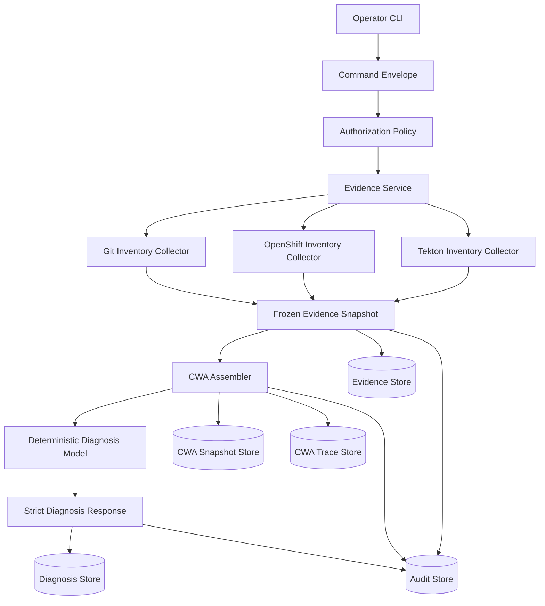

# Implemented Architecture

## Position

Aura is a read-only sidecar control plane. Existing systems remain authoritative:

| Data | Authority |
| --- | --- |
| Desired cluster definition | `fleet-clusters` Git commit at `HEAD` |
| Actual cluster state | OpenShift |
| Workflow execution | Tekton |
| Operator request data | Portal, when eventually integrated |
| Aura commands, evidence, CWA traces, and audit records | Aura |

Aura freezes observations, correlates them, and explains them.

## Flow



## Layers

| Layer | Responsibility |
| --- | --- |
| CLI | Parses arguments, validates flag combinations, wires collectors, prints JSON |
| Services | Enforce command type, state transition, and operator authorization |
| Collectors | Read external systems and produce typed evidence items |
| Correlators | Combine source evidence into cluster, workflow, and diagnosis views |
| CWA | Freeze model input into nine required slots and compute digests |
| Diagnosis | Validate strict model output and link it to CWA provenance |
| Stores | Persist immutable JSON records with atomic exclusive publication |
| Audit | Record evidence collection, context assembly, and model results |

## Read-Only Boundary

Phase 1 performs only these external reads:

| Source | Read |
| --- | --- |
| Git | Committed definition files and the `deprovision/` listing from `HEAD` |
| OpenShift | `clusterdeployments` and `managedclusters` |
| Tekton | `pipelineruns` and `taskruns` |

Aura does not:

- Write Git files.
- Create, update, patch, or delete Kubernetes resources.
- Start or cancel PipelineRuns.
- Write Portal data.
- Publish messages to RabbitMQ.
- Send cluster evidence to an external model provider.

## Evidence and Provenance

Every collected result is a typed `EvidenceSnapshot`. It contains:

- Snapshot and command IDs.
- Collector name and version.
- Collection timestamp.
- Source name and version.
- Typed evidence items.
- Redaction list.
- SHA-256 snapshot digest.

The CWA assembler links an evidence snapshot to a CWA snapshot and trace. A diagnosis links to the CWA snapshot and includes a response digest. Audit events connect the command to all of those records.

## Model Boundary

The current diagnosis model is deterministic and local. No external provider is configured.

The provider-independent contract is:

1. Receive a `CWASnapshot`.
2. Return a strict `DiagnosisResponse`.
3. Never mutate evidence.
4. Never bypass authorization.
5. Never execute an action.

Model output is untrusted data. Pydantic validates the exact response shape, confidence bounds, evidence references, and digests.

## Refusal

`diagnose state` refuses to answer if required evidence is missing:

| Missing evidence | Refusal message component |
| --- | --- |
| Git definition | `Git cluster definition` |
| Git required files, unless deprovision is requested | `Git cluster definition files` |
| Interpretable Git definition, unless deprovision is requested | `Valid Git cluster definition` |
| Single Git definition | `Conflicting Git cluster definitions` |
| Selected PipelineRun | `Selected Tekton PipelineRun NAME_OR_UID` |
| OpenShift `Provisioned` condition | `OpenShift Provisioned condition` |
| OpenShift actual state, unless an active definition has a deprovision sentinel | `OpenShift actual state` |
| ManagedCluster status | `ManagedCluster status` |
| Tekton run, unless deprovision is requested | `Tekton PipelineRun status` |

The command exits with code `2`. Evidence, CWA snapshot, CWA trace, and audit records are still preserved.

## Proposals

`propose deprovision` turns the same cluster-state evidence into a deterministic, digest-verified `Proposal` that adds `deprovision/<id>-archive`. Aura stores the proposal and never applies it, commits it, or pushes it. Unmet preconditions refuse the command with every reason, and the evidence, CWA, and audit records are preserved.

## Execution Store

Phase 3 commands keep their records in the execution store in `aura.execution.store` ([D13](plans/06-phase-3-approved-execution.md#execution-store)). Its connection comes only from Aura's configuration file, `aura.config`: TOML at `$XDG_CONFIG_HOME/aura/config.toml`, default `~/.config/aura/config.toml`, or the file the `AURA_CONFIG` environment variable names. A missing, unreadable, or invalid file, or a blank `AURA_CONFIG` or `XDG_CONFIG_HOME`, is an error.

```toml
[store]
backend = "sqlite"
path = "/absolute/path/aura.db"
login = "<operator>"

[execution]
adapters = []
adapter_timeout_seconds = 300
max_dispatches_per_hour = 5
executor_kubeconfig = "/absolute/path/.kube/aura-executor"

[git]
author_name = "<name>"
author_email = "<email>"
```

A `postgresql` store takes `host`, `port` (default `5432`), `database`, `user`, and an absolute `password_file` instead of `path` and `login`. `adapters` lists enabled adapters from `git_handoff`, `git_pr`, `tekton`, and `recording`; `tekton` requires the absolute `executor_kubeconfig` of `aura-executor`. `adapter_timeout_seconds` bounds an adapter's write, and `max_dispatches_per_hour` is G11's hourly limit. `[execution]` and `[git]` are optional.

The store only inserts rows. Each row holds its record's canonical JSON as text, its digest, copies of the fields that constraints and queries use, and `stored_at` from the database. Load verifies the record's own digest and that the digest column and every copied column equal the record's fields. A signed record, an approval, an execution record, or a PipelineRun observation, is also verified against the hub's allowed-signers list at the row's `stored_at`, so a key retired later still verifies it; a reader without the list cannot read signed rows. An identical insert under a stored key succeeds; a different record under it is a conflict. When a write's outcome is unknown, the store reads the row back by its key: an identical row counts as stored, an absent row is a failed write, and an unreadable store raises an error that names the key. A locked check-and-insert transaction lets two writers that check the same condition commit at most once. Idempotency keys are unique per login, and each login reads only its own commands.

The schema is versioned by migration files in `aura/execution/migrations/` that only add tables, columns, and indexes. A client refuses a store whose highest version is outside the range it supports. A new SQLite file applies the migrations and records a deployment ID when it is created, for development. On PostgreSQL the database administrator applies the migrations, inserts the deployment ID, and runs `aura/execution/postgresql/grants.sql`, which gives role `aura_operator` `INSERT` and `SELECT` on the record tables, `SELECT` on `schema_versions` and `deployment`, and `INSERT` on every `commands` column except `login`, whose default is `CURRENT_USER`; the file can be run again. The administrator creates the role and each operator's login. Each operator logs in as a member of that role; Aura reads the password from the configured file and runs the session in UTC. PostgreSQL runs the locked check-and-insert at `SERIALIZABLE`, so a transaction that loses to a concurrent one is a conflict. `proposal submit`, `proposal approve`, and `proposal reject` write to the store, and `proposal status` reads it with `--openshift-kubeconfig`. A command's artifact, a publication or an approval, is inserted in one transaction with its terminal record, so a command that stores no terminal record leaves no artifact. `execute` is the exception: its regeneration records and execution records are stored as soon as they exist, each after its event. Schema version 3 adds `cwa_snapshots`, `cwa_traces`, and `regenerated_proposals` for G8's regeneration, and version 4 adds `resolution_confirmations`, signed with `aura-approve`, for `execution confirm`. `execution status` reads a row's `stored_at` through the store to time a resolution.

## Command Guard

`aura.execution.guard.check` runs the Phase 3 [guard rules](plans/06-phase-3-approved-execution.md#guard) G1–G12 in order and refuses at the first that fails, naming it. G2 runs first: it signs a payload with the executor's key and verifies it as `aura-execute` against the hub list, so an unsigned caller learns nothing about a proposal. G2 also refuses an executor whose clock is more than five minutes ahead of the database's, because the records it signed would fail to load. The publication then loads (G3) before G1, because G1 reads its type. A record that fails verification is a refusal under the rule that reads it (G3, G5, or G6); a store that cannot be read fails the command. G5 counts unexpired approvals of the exact proposal and action digests from distinct principals other than the executor. G6 requires the derived state, including execution records, to be `approved`, ignoring staleness, which G7 checks. G10 selects `recording` when it is enabled, otherwise `git_handoff` for Git proposals and `tekton` for reruns, refuses an adapter whose `target` names the EventListener, allows `recording` only on SQLite, and allows a real adapter only on the PostgreSQL store the hub names. G11 counts the past hour's dispatches by the database's clock against `max_dispatches_per_hour`. G12 runs the adapter's read-only preflight. The dispatch transaction rechecks G5, G6, and G11 with a fresh clock. The checks that read the hub or Git, and the regeneration of G8, are passed in, so tests supply them. G8's regeneration runs under the execute command's ID and stores `evidence_collected` and the evidence snapshot, `context_assembled` and the CWA snapshot, the CWA trace, and `proposal_created` and the regenerated proposal; a regeneration refusal stores the trace and no proposal. A change that breaks the contract usually changes the approved action too, so G5 refuses it before G9.

`execute` treats an adapter's result as unknown, leaving the execution `awaiting_operator`, when the write raises or returns a result for another request or execution. It redacts secret-named values in the result before storing it, and stamps the result record after the call.

## Tekton Adapter

`aura.execution.tekton.TektonAdapter` creates the approved post-provision PipelineRun with `oc --kubeconfig <executor_kubeconfig> create -n openshift-pipelines -f - -o json`, bounded by `adapter_timeout_seconds`. Only this module and `aura.config` read `executor_kubeconfig` (I10). The run is named `aura-rerun-<proposal-id>`, 47 characters, without the proposal's `generateName`, and carries the proposal-ID and execution-ID annotations. The adapter refuses, before calling `oc`, a manifest that is not a `tekton.dev` PipelineRun of pipeline `post-provision` in `openshift-pipelines`. Outcomes:

| `oc create` outcome | Result |
| --- | --- |
| Created, and the output names the run with a UID | `submitted`, with the run's name, UID, and namespace |
| The server refused it: `Forbidden`, `Unauthorized`, `NotFound`, `BadRequest`, `Conflict`, `Invalid`, and similar | `failed`, with only the reason class stored, because the server's text may quote the manifest |
| `oc` cannot start | `failed` |
| `AlreadyExists`, a timeout, a server or connection error, or output that does not name the run | Unknown: the execution is `awaiting_operator` |

Its G12 preflight runs `oc auth can-i create pipelineruns.tekton.dev -n openshift-pipelines` with the same kubeconfig and requires `yes`. It never retries.

## Failure Model

| Failure | Current behavior |
| --- | --- |
| Missing flag | CLI error, exit code `2` |
| Unauthorized role | Service error, exit code `2` |
| Missing diagnosis evidence | Refusal, exit code `2`, records preserved |
| Unmet proposal precondition | Refusal, exit code `2`, no proposal stored, other records preserved |
| Duplicate immutable record | Store error, exit code `2` |
| External `oc` failure | Converted to `OpenShiftCLIError`; CLI reports a concise error and exits `2` without partial JSON |
| Model unavailable | Generic diagnosis service falls back deterministically |
| Terminal idempotency key reused | CLI exits `2` before evidence collection and creates no new records |
| Idempotency key reused for a different request | CLI exits `2` before evidence collection |
| Record write failure | Command stored as `failed` when possible; CLI exits `2` with the operating-system error |
| Unreadable idempotency-key record | CLI exits `2` before evidence collection |
| Unhandled error after the idempotency check | CLI prints `aura: internal error`, or `aura: filesystem error` for an `OSError`, stores a `failed` record unless a terminal record is already stored or a `refused` record when the chain already ends with `command_refused`, and exits `2` |
| Invalid Git definition | Emitted as `cluster_definition_invalid`; other definitions are still collected |

Command records are written only in a terminal state. `succeeded`, `failed`, and `refused` records are immutable; a new attempt requires a new idempotency key.
