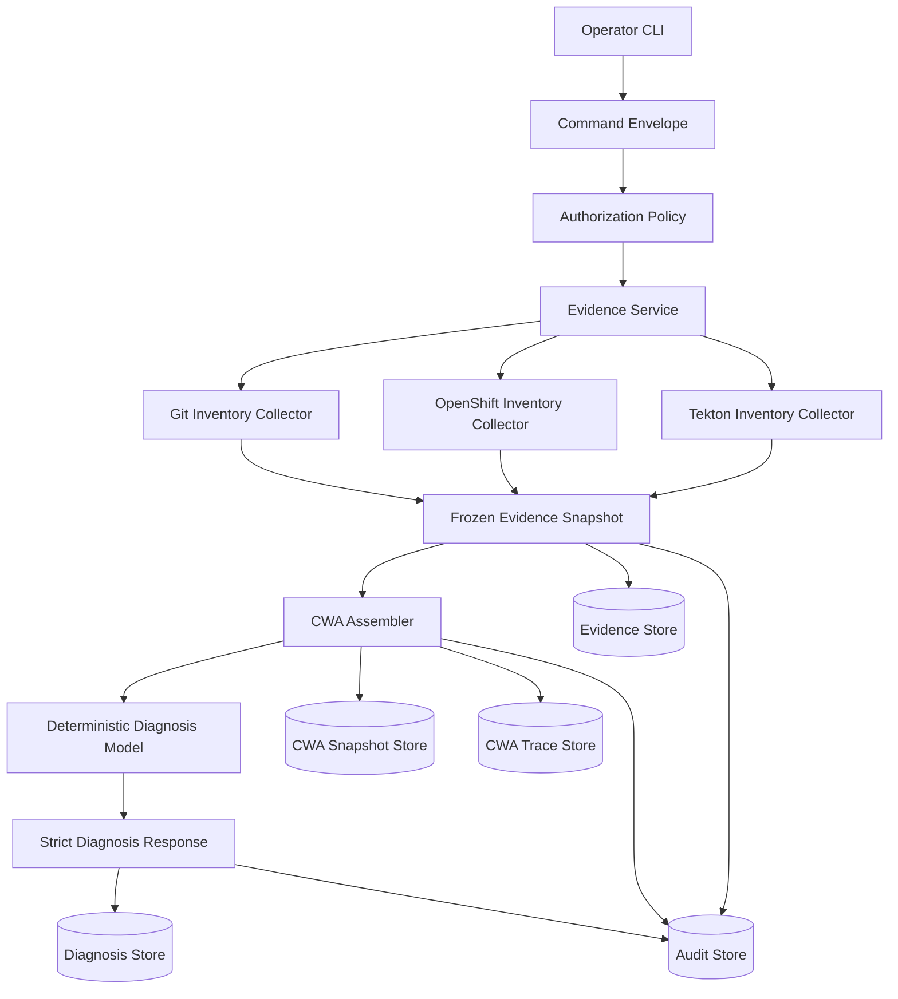

# Implemented Architecture

## Position

Aura is a read-only sidecar control plane. Existing systems remain authoritative:

| Data | Authority |
| --- | --- |
| Desired cluster definition | `fleet-clusters` Git commit at `HEAD` |
| Actual cluster state | OpenShift |
| Workflow execution | Tekton |
| Operator request data | Portal, when eventually integrated |
| Aura commands, evidence, CWA traces, and audit records | Aura |

Aura does not become the source of truth. It freezes observations, correlates them, and explains them.

## Flow

## Layers

| Layer | Responsibility |
| --- | --- |
| CLI | Parses arguments, validates flag combinations, wires collectors, prints JSON |
| Services | Enforce command type, state transition, and operator authorization |
| Collectors | Read external systems and produce typed evidence items |
| Correlators | Combine source evidence into cluster, workflow, and diagnosis views |
| CWA | Freeze model input into nine required slots and compute digests |
| Diagnosis | Validate strict model output and link it to CWA provenance |
| Stores | Persist immutable JSON records with atomic exclusive publication |
| Audit | Record evidence collection, context assembly, and model results |

## Read-Only Boundary

Phase 1 performs only these external reads:

| Source | Read |
| --- | --- |
| Git | Committed YAML files from `HEAD` |
| OpenShift | `clusterdeployments` and `managedclusters` |
| Tekton | `pipelineruns` and `taskruns` |

Aura does not:

- Write Git files.
- Create, update, patch, or delete Kubernetes resources.
- Start or cancel PipelineRuns.
- Write Portal data.
- Publish messages to RabbitMQ.
- Send cluster evidence to an external model provider.

## Evidence and Provenance

Every collected result is a typed `EvidenceSnapshot`. It contains:

- Snapshot and command IDs.
- Collector name and version.
- Collection timestamp.
- Source name and version.
- Typed evidence items.
- Redaction list.
- SHA-256 snapshot digest.

The CWA assembler links an evidence snapshot to a CWA snapshot and trace. A diagnosis links to the CWA snapshot and includes a response digest. Audit events connect the command to all of those records.

## Model Boundary

The current diagnosis model is deterministic and local. No external provider is configured.

The provider-independent contract is:

1. Receive a `CWASnapshot`.
2. Return a strict `DiagnosisResponse`.
3. Never mutate evidence.
4. Never bypass authorization.
5. Never execute an action.

Model output is untrusted data. Pydantic validates the exact response shape, confidence bounds, evidence references, and digests.

## Refusal

`diagnose state` refuses to answer if required evidence is missing:

| Missing evidence | Refusal message component |
| --- | --- |
| Git definition | `Git cluster definition` |
| Git required files | `Git cluster definition files` |
| Interpretable Git definition | `Valid Git cluster definition` |
| OpenShift actual state | `OpenShift actual state` |
| ManagedCluster status | `ManagedCluster status` |
| Tekton run | `Tekton PipelineRun status` |

The command exits with code `2`. Evidence, CWA snapshot, CWA trace, and audit records are still preserved.

## Failure Model

| Failure | Current behavior |
| --- | --- |
| Missing flag | CLI error, exit code `2` |
| Unauthorized role | Service error, exit code `2` |
| Missing diagnosis evidence | Refusal, exit code `2`, records preserved |
| Duplicate immutable record | Store error, exit code `2` |
| External `oc` failure | Converted to `OpenShiftCLIError`; CLI reports a concise error and exits `2` without partial JSON |
| Model unavailable | Generic diagnosis service falls back deterministically |
| Terminal idempotency key reused | CLI exits `2` before evidence collection and creates no new records |
| Idempotency key reused for a different request | CLI exits `2` before evidence collection |
| Record write failure | Command stored as `failed` when possible; CLI exits `2` with the operating-system error |
| Unreadable idempotency-key record | CLI exits `2` before evidence collection |
| Invalid Git definition | Emitted as `cluster_definition_invalid`; other definitions are still collected |

Command records are written only in a terminal state. `succeeded`, `failed`, and `refused` records are immutable; a new attempt requires a new idempotency key.
