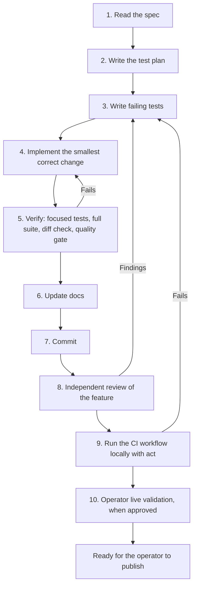

# Development Workflow

This is the required way to change Aura. [`AGENTS.md`](../AGENTS.md) summarizes it; this document is the detail. It applies to every behavior change, whoever writes it.

## Why This Exists

On 2026-10-23, an independent review of 16 unpublished commits found seven defects that the test-first workflow had not caught. None was a happy-path bug. Each was one of:

| Class | Example |
| --- | --- |
| Partial-failure write order | A proposal was stored before its CWA trace and audit events, so a later write failure left a ready proposal with broken provenance |
| Unhandled failure path | An OS error reading a proposal escaped the command's error handling and left no terminal command record |
| Library assumption | `Path.glob` silently ignores an unreadable directory, so an unreadable store looked empty |
| Input edge case | A repeated `--proposal-id` produced duplicate evidence items |
| Spec-to-test gap | The spec said "empty file"; the contract accepted any file at that path because only the generator was tested |
| Untested invariant | `command_failed` linked to the wrong predecessor, forking the audit chain |

The root cause was process, not test-first ordering:

1. The same author wrote the tests and the code from one mental model, so the tests shared its blind spots.
2. Tests covered intended behavior and refusals, not failure paths, invariants, or hostile input.
3. Plans, checklists, and task trackers recorded what to build, not how to show it is correct.
4. The structural quality gate measures code shape, not behavior.

Writing a test first fixes the order of work. It does not make the test cover the right cases. The steps below do.

## Feature Lifecycle



### 1. Read the Spec

Read the governing plan in `docs/plans/` and the contract docs (`docs/cli.md`, `docs/evidence.md`, `docs/wiring.md`). If the spec is silent or ambiguous on behavior the change needs, ask the operator before writing code. Do not decide product behavior silently.

### 2. Write the Test Plan

Before any test or code, list the cases in five classes. The plan goes in the task description or the commit series notes; it must exist before step 3.

| Class | What to list | Source |
| --- | --- | --- |
| Behavior | Successful results and documented refusals | Spec examples and acceptance criteria |
| Contract negatives | One negative test per spec rule that says *only*, *exactly*, *empty*, *must*, *must not*, or *never*. It targets the contract or validator directly, not only the generator | Spec rules |
| Failure modes | Every external read and every record write in the command, each forced to fail; see the [failure-mode matrix](#failure-mode-matrix) | The command's write order in `docs/wiring.md` |
| Invariants | Which [project invariants](#project-invariants) the change touches | This document |
| Input edges | The [input edge checklist](#input-edge-checklist) items that apply | This document |

Every rule in the spec maps to at least one test. If a rule cannot be tested, say so in the plan and ask the operator.

### 3. Write Failing Tests

Write the tests from the plan. Run them and read each failure: a test must fail because the behavior is missing, not because of an import error or a broken fixture. A test that passes before the implementation exists is testing nothing new; fix it or remove it.

Test conventions are in [`AGENTS.md`](../AGENTS.md#test-guidance). In particular:

- Correlation and generator tests use the real `GitInventoryCollector` over a temporary Git tree.
- Failure tests force the failure deterministically, for example by pre-creating a record at its deterministic ID, replacing a directory with a file, or removing permissions. They do not rely on timing.
- Tests do not rely on file modes to make a path unreadable, because root ignores them and `act`'s runner image runs as root. Use `deny_access` from `tests/failure_injection.py` to raise `PermissionError` for one path. Tests that do change permissions restore them so temporary directories can be cleaned up.

### 4. Implement

Make the smallest correct change. Match the surrounding style. Before relying on a standard library or third-party call to read a store, input, or external system, confirm how it reports errors. Prefer calls that raise over calls that skip or return empty; an `OSError` swallowed by a helper is a fail-open bug.

### 5. Verify

Run all of these before every commit, in this order:

```bash
UV_CACHE_DIR=/private/tmp/aura-uv-cache uv run --no-sync pytest tests/test_<area>.py
```

```bash
UV_CACHE_DIR=/private/tmp/aura-uv-cache uv run --no-sync pytest
```

```bash
git diff --check
```

The quality gate compares committed trees, so run it on a candidate commit and amend that unpushed commit if it reports anything:

```bash
ripwire . --quality-delta=adb2c2b..HEAD
```

A change is not finished while the gate reports gating findings. The gate is a structural proxy: passing it says nothing about correctness, and clearing its findings is never a substitute for the test plan. Acknowledge a finding in `.ripwire_quality_acks` only when it is a confirmed false positive, with a specific reason, using `--ack-only=gating` or a precise substring. Commit acknowledgements separately.

### 6. Update Docs

Update affected documentation in the same commit series, following the [Documentation Rules](../AGENTS.md#documentation-rules). A doc that states something the code does not do is a defect.

### 7. Commit

Use Conventional Commits with `git commit -s`. Each commit must pass step 5 on its own. Amend only unpushed commits. Never commit with failing tests or gating findings. Aura never pushes; the operator publishes.

### 8. Independent Review

Each feature gets an independent review before it is reported done, not after a batch of features.

- The reviewer is a person or a separate agent that did not write the change. Give it the diff range, the spec, and the contract docs. Do not give it the author's conclusions or reasoning.
- Ask for correctness, spec conformance, failure paths, regressions to existing commands, security, and doc accuracy, with a concrete failure scenario for each finding.
- The author reproduces every finding before acting on it. A confirmed finding is fixed test-first: write the failing test, then the fix.
- Product decisions raised by the review go to the operator.

### 9. Run the CI Workflow Locally

Before reporting a feature ready to publish, run `.github/workflows/ci.yml` locally with [`act`](https://github.com/nektos/act) on a clean, committed tree. `act` copies the working tree, so uncommitted files would be tested but not published. It runs the same steps as GitHub CI in a Linux container, with the Python version CI pins.

With Podman, pull the medium runner image once:

```bash
podman pull docker.io/catthehacker/ubuntu:act-latest
```

Then run the workflow:

```bash
DOCKER_HOST="unix://$(podman machine inspect --format '{{.ConnectionInfo.PodmanSocket.Path}}')" act push -j test -P ubuntu-latest=catthehacker/ubuntu:act-latest --container-daemon-socket - --pull=false
```

With Docker, omit `DOCKER_HOST`. `--container-daemon-socket -` keeps the host socket out of the job container, which the workflow does not need.

The job must succeed. Known differences from GitHub's hosted runners:

- The runner image runs steps as root, so tests must not depend on file modes.
- On Apple silicon the container is `linux/arm64`; GitHub runs `linux/x86_64`.
- The image approximates the hosted runner, and `setup-python` and `setup-uv` still download from the network.

A passing `act` run makes a passing GitHub run likely, not certain. GitHub CI on the published commit remains the authority, and the operator confirms it after publishing.

### 10. Operator Live Validation

Live cluster access requires explicit operator approval for each run. By default, provide the commands and expected results for the operator to run, as in [Validation](validation.md). Use placeholders such as `<cluster>`; do not assume a test cluster still exists. Record each run with its date, Aura commit, the clusters used, and the outcome.

## Project Invariants

Every command must preserve these. A change that touches an invariant must have a test that asserts it.

| ID | Invariant |
| --- | --- |
| I1 | A command that passes argument validation and the idempotency check stores exactly one terminal record: `succeeded`, `failed`, or `refused`. The only exception is a command store that cannot be written. |
| I2 | A command's audit events form a linear chain. Every `previous_event_id` names a stored event of the same command, no two events share a predecessor, and `command_failed` or `command_refused` names the last event actually stored. |
| I3 | Actionable artifacts are written last. A stored proposal always has its CWA trace and `proposal_created` event, with matching IDs and digests. Phase 3 approval records follow the same rule. |
| I4 | Stores are append-only and leave no partial or empty final record. A write that raises leaves no final record, including when the directory sync fails after the record is linked. |
| I5 | Aura writes nothing to Git, Kubernetes, Portal, or RabbitMQ in Phases 1 and 2, and never modifies a protected repository. |
| I6 | Stored records contain no secret values. |
| I7 | Expected failures (argument, authorization, Git, `oc`, store, and filesystem errors) exit `2` with a concise message and no traceback. A traceback is a bug. |
| I8 | Fail closed: a missing, unreadable, or malformed input is an error, never an empty or default result. |
| I9 | IDs and digests are deterministic for the same inputs, and every digest is verified on load. |

## Failure-Mode Matrix

For each command, list every step that reads external state or writes a record, force each one to fail, and assert the outcome. Template:

| Step that fails | Exit | Terminal record | Actionable artifacts left | `command_failed` links to |
| --- | --- | --- | --- | --- |
| `command_received` audit write | `2` | `failed` | None | None |
| Evidence collection (Git, `oc`, store read) | `2` | `failed` | None | `command_received` |
| Evidence snapshot or `evidence_collected` write | `2` | `failed` | None | `command_received` |
| CWA snapshot, diagnosis record, or CWA trace write | `2` | `failed` | No proposal | `evidence_collected` |
| `context_assembled` write | `2` | `failed` | No proposal | `evidence_collected` |
| Response event write (`model_called` or `proposal_created`) | `2` | `failed` | No proposal | `context_assembled` |
| Proposal write | `2` | `failed` | No proposal | `proposal_created` |
| Terminal command record write | `2` | None | Prior records only | Not applicable |
| Any error the route does not handle, after the idempotency check | `2` | `failed`, unless a terminal record is already stored; `refused` when the chain already ends with `command_refused` | No proposal | The last audit event stored; no new event after `command_refused` |

Rows that do not apply to a command are omitted from its matrix. A new command or write step adds rows. Actionable artifacts are records a later phase could act on, currently proposals. Evidence snapshots, CWA snapshots and traces, and diagnosis records written before the failure may remain as provenance.

### Shared Harness

`tests/test_failure_matrix.py` applies the matrix to every command automatically:

1. It runs each scenario once and records every store write. All writes go through `save_private_json`, which `tests/failure_injection.py` intercepts.
2. It asserts that the recorded write labels equal the scenario's documented write order. This pins the order in `docs/wiring.md`, so moving a write is a visible, reviewed change. It also asserts that every record file the run created was recorded, so a write that bypasses `save_private_json` fails the test.
3. It reruns the scenario once per write, failing only that write with an `OSError`, in two phases: before anything is written, and after the record is linked into place when the directory sync fails. Each run must exit `2`, print nothing to standard output, and store a `failed` record. The writes after the failure must be exactly the `failed` terminal record and, when audited, `command_failed`. The exception is a failure of the final terminal-record write, which leaves no record and is followed by no write. No proposal from that command may remain, and `command_failed` must link to the last audit event stored before the failure.
4. For each error type a command's route handles, it replaces the collector with one that raises it and asserts a `failed` record and the chain `command_received` then `command_failed`.
5. It replaces the collector with one that raises `RuntimeError`, `RecursionError`, or `UnicodeDecodeError`, which no route handles, and asserts standard error `aura: internal error: <type>: <message>`, a `failed` record, and the same chain. For each proposal scenario and `diagnose`, it makes the generator or diagnosis model raise `RuntimeError` and asserts the chain ends `evidence_collected` then `command_failed`.

`tests/invariants.py` provides:

- `assert_command_invariants`, which checks the records a command left:
  - I1: exactly one terminal record for the command;
  - I2: a linear audit chain whose last event matches the record, and at least one event when an audit directory is in use;
  - I3: provenance for every proposal written during the run, and no proposal left by a failed or refused command;
  - I4: no partial or empty record, and every record that existed before the run unchanged.
- `record_files`, which snapshots records before a run.
- `command_chain`, which returns a command's audit events in chain order after asserting I2.

Every matrix run calls the invariant check. Other CLI tests may call it too.

To cover a new command, or a new outcome of an existing command, add a `Scenario` with its builder and its documented write order. Rows for new write steps are then tested without further code.

## Input Edge Checklist

- Empty input, empty directory, and missing directory.
- Unreadable file and unreadable directory.
- A path that is a file where a directory is expected, and the reverse.
- Repeated flags and duplicate IDs.
- Names that are not valid IDs, including stray files in a record directory.
- Tampered records whose digest no longer matches.
- Blank, whitespace, and invalid-format values, such as a non-DNS-1123 cluster name.
- Conflicting sources, such as an active and an archived definition for one cluster.

## Task Tracking

Plans, checklists, and task trackers record scope and progress. They do not show correctness: a completed checkbox means the work was done, not verified. A task is done only when it meets the Definition of Done in [`AGENTS.md`](../AGENTS.md#definition-of-done). When an implementation task is broken into subtasks, include:

1. Test plan, covering all five classes.
2. Failing tests.
3. Implementation.
4. Verification and docs.
5. Independent review and its fixes.

## Adoption Status

Adopted on 2026-10-23.

| Practice | Status |
| --- | --- |
| Failure-injection harness | In place for every command: inventory list with no record directories, audit only, through CWA, and through diagnosis; workflow inspect with none or with snapshot and audit; diagnose state succeeded and refused; propose deprovision succeeded and refused; propose cluster-edit adding a file, appending keys, and refused; propose post-provision-rerun proposed and refused; propose scaffold proposed and refused, with a real scaffold run; proposal status with none or with snapshot and audit. The scenarios are listed in `tests/test_failure_matrix.py`. When it had 62 matrix tests, 19 failed against the CLI from commit `0416058`, before the review fixes. It found a store defect, fixed in `17b06d3`: a directory sync failure after linking left records that callers treated as unwritten. |
| Invariant check for I1–I4 | In place. It runs after every matrix run. Existing per-command CLI tests do not call it yet. |
| Local CI with `act` | Adopted. On its first run, at `4c2d2b5`, it ran Python 3.13.17 on `linux/arm64` as root and failed three `chmod`-based tests that GitHub CI had passed; they now use `deny_access`. |
| Mutation testing | Not adopted. When adopted, run it periodically on changed modules to confirm that tests constrain the code. |

The harness does not cover failures of the command-store lock, the idempotency check, or the failure-path writes themselves, such as the `command_failed` audit write. Existing CLI tests cover the lock and idempotency check; a failing failure-path write is not yet tested.
