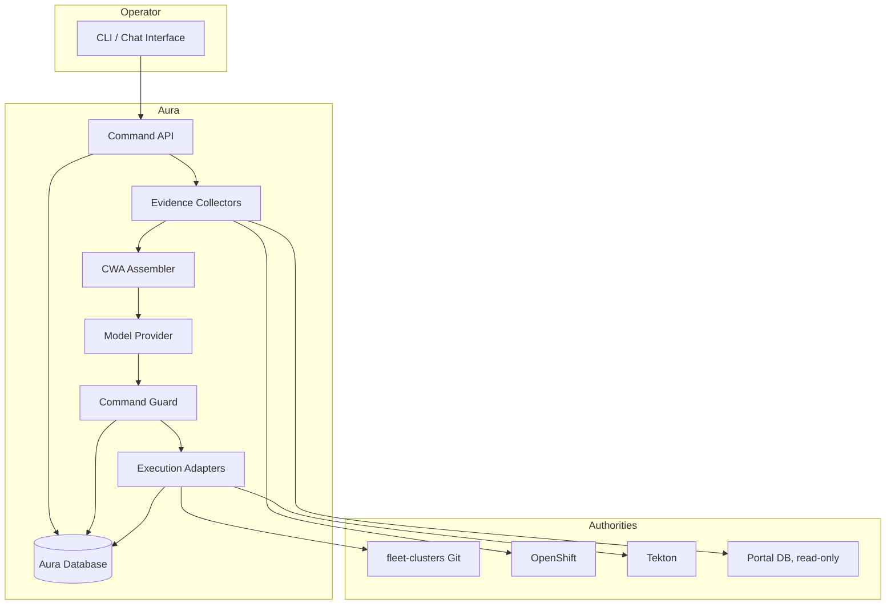

# Target Architecture

## Goals

1. Make manual partner-labs management faster and less error-prone.
2. Explain current cluster and workflow state in operator-friendly language.
3. Generate reviewable patches and action proposals.
4. Execute only approved, validated, auditable commands.
5. Keep `fleet`, `fleet-cluster-scaffold`, `fleet-clusters`, and `portal` unchanged.
6. Use CWA for every model call.

## Architecture



## Core Components

### 1. Operator Interface

Initial interface should be a CLI or chat command surface. A web UI is optional and should not be required for the first release.

Supported operator actions:

- Ask for cluster inventory.
- Ask why a workflow is stuck.
- Request a proposed change.
- Review a generated patch.
- Approve or reject an action.

### 2. Command API

The Command API is the only path from the operator to Aura's execution layer.

Command families:

| Command | Phase | Side effect |
| --- | --- | --- |
| `inventory.list` | Phase 1 | None |
| `workflow.inspect` | Phase 1 | None |
| `diagnose.state` | Phase 1 | None |
| `propose.patch` | Phase 2 | None |
| `propose.pipeline` | Phase 2 | None |
| `execute.patch` | Phase 3 | Git patch or PR |
| `execute.pipeline` | Phase 3 | Tekton PipelineRun |

### 3. Evidence Collectors

Evidence collectors are deterministic adapters. They gather current facts before a model call.

Required collectors:

| Collector | Source | Output |
| --- | --- | --- |
| Git inventory | `fleet-clusters` | Cluster directories, tiers, regions, desired state |
| OpenShift inventory | Kubernetes API | ClusterDeployment, ManagedCluster, conditions, namespaces |
| Tekton inventory | Kubernetes API | PipelineRun and TaskRun status |
| Fleet documentation | `fleet` docs | Pipeline and lifecycle explanations |
| Portal reporting | Portal DB, optional | Operator-visible labels and request metadata |

Collectors must:

- Run deterministically.
- Return typed JSON.
- Redact secrets.
- Record source version or resource version.
- Never write to protected systems.

### 4. CWA Integration

Every model call uses a conformant CWA assembler.

Minimum slot mapping:

| CWA slot | Aura producer |
| --- | --- |
| `governance.instructions` | Aura operating policy and safety rules |
| `governance.capabilities` | Allow-listed execution adapters |
| `governance.output_contract` | Strict JSON response schema |
| `state.task` | Current command, approval state, and retry count |
| `state.user` | Authenticated operator identity and permissions |
| `evidence.tool_results` | OpenShift, Tekton, Git, and Portal observations |
| `evidence.knowledge` | Fleet documentation and runbook excerpts |
| `interaction.query` | Operator request |
| `interaction.history` | Current conversation or command context |

CWA must provide:

- Frozen input snapshot.
- Deterministic payload assembly.
- Trace and snapshot digest.
- Refusal when required evidence is missing.
- No model call during assembly.

### 5. Command Guard

The guard is deterministic code outside the model.

Validation sequence:

1. Parse model output.
2. Validate against the command JSON Schema.
3. Validate operator permissions.
4. Validate target resource scope.
5. Check idempotency key.
6. Require human approval.
7. Execute through an allow-listed adapter.
8. Record the result.

The guard may reject a model proposal. The model cannot override the guard.

### 6. Execution Adapters

Adapters are narrow, versioned, and independently testable.

| Adapter | Responsibility | Writes to protected repo? |
| --- | --- | --- |
| `scaffold` | Invoke `fleet-cluster-scaffold` | No |
| `git-patch` | Generate a patch against `fleet-clusters` | No, unless explicitly approved |
| `git-pr` | Open a PR against `fleet-clusters` | Operational change only |
| `tekton` | Start and monitor a PipelineRun | No |
| `notify` | Send operator notification | No |

If operational changes to `fleet-clusters` are not allowed, the `git-pr` adapter remains disabled and Aura returns a patch for manual application.

## State Ownership

| Data | Owner |
| --- | --- |
| Desired cluster definition | `fleet-clusters` Git |
| Actual cluster state | OpenShift |
| Workflow execution | Tekton |
| Operator-facing request data | Portal database |
| Aura commands, approvals, traces, and audit records | Aura database |

Aura must reconcile its views from Git and OpenShift. It must not maintain a competing cluster inventory as the source of truth.

## Database Model

Minimum Aura tables:

| Table | Purpose |
| --- | --- |
| `operators` | Identity and authorization metadata |
| `commands` | Requested operator action and current state |
| `evidence_snapshots` | Frozen collector output |
| `cwa_traces` | Snapshot digest, trace, model provider, and response digest |
| `proposals` | Validated model proposal and patch metadata |
| `approvals` | Human approval or rejection |
| `executions` | Adapter execution and result |
| `audit_events` | Immutable action history |

The database stores command and audit state, not authoritative cluster state.

## Repository Strategy

Initial implementation should live in this repository to avoid premature fragmentation:

```text
aura/
  docs/plans/
  contracts/
  src/
  tests/
```

Split repositories only after a stable boundary exists, such as:

- `aura-contracts`
- `aura-service`
- `aura-adapters`

