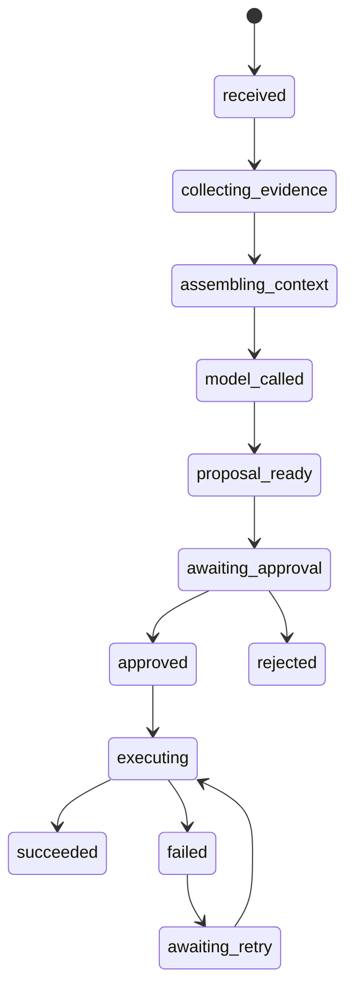

# Phase 0: Baseline

## Objective

Establish Aura's contracts, access model, and evidence schema before implementing the assistant.

Phase 0 performs no model calls and no side effects.

## Deliverables

1. Command JSON Schemas. Superseded: the command, evidence, CWA, diagnosis, and proposal contracts are Pydantic models, and `tests/test_contract_schemas.py` exports each as JSON Schema whose properties match the model's fields (D4 in the [closure plan](10-phase-0-2-closure.md#operator-decisions)).
2. Evidence collector output schemas.
3. Adapter interface definitions.
4. Authorization model.
5. Secret-redaction rules.
6. Audit event schema.
7. Local development environment.
8. Initial test fixtures from the protected repositories.

## Command Contract

Define a base envelope:

| Field | Purpose |
| --- | --- |
| `command_id` | Unique Aura command identifier |
| `command_type` | Command family |
| `operator_id` | Authenticated operator |
| `created_at` | Command creation time |
| `input` | Typed command input |
| `idempotency_key` | Operator-supplied or generated key |
| `status` | Current command state |

Command states:

Phase 0 only needs to define these states; it does not need to implement all of them.

## Evidence Contract

Each collector returns:

| Field | Purpose |
| --- | --- |
| `collector` | Collector name and version |
| `collected_at` | Collection time |
| `source` | Source system |
| `source_version` | Git commit, resource version, or database cursor |
| `items` | Typed observations |
| `redactions` | Redacted field names, without values |

## Authorization Model

Initial roles:

| Role | Permission |
| --- | --- |
| `viewer` | Read inventory and diagnosis |
| `proposer` | Generate patches and action proposals |
| `approver` | Approve or reject proposals |
| `executor` | Trigger approved adapters |
| `admin` | Manage Aura configuration |

Separate `proposer` and `approver` when possible.

## Access Requirements

| System | Access | Notes |
| --- | --- | --- |
| `fleet` | Read-only local Git | Documentation and pipeline definitions |
| `fleet-clusters` | Read-only local Git | Inventory and patch base |
| `fleet-cluster-scaffold` | Execute in isolated environment | No repository modification |
| OpenShift | Read-only Kubernetes API | Inventory and Tekton status |
| Tekton | Start PipelineRun only in Phase 3 | Separate ServiceAccount |
| Portal DB | Read-only or none | Optional reporting source |

## Security Baseline

1. Model context receives no secret values.
2. Kubernetes credentials stay in the adapter process.
3. Git credentials stay in the Git adapter.
4. Every model response is treated as untrusted input.
5. Every command is idempotent.
6. Audit records are append-only.

## Acceptance Criteria

- All command and evidence schemas validate representative fixtures.
- A read-only Git inventory collector returns typed cluster data.
- A read-only OpenShift collector returns typed cluster and PipelineRun status.
- Redaction removes known secret fields before evidence storage.
- Authorization rules reject unauthorized command types.
- No protected repository is modified.

