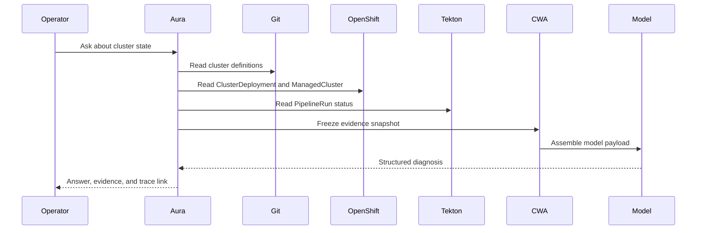

# Phase 1: Read-Only Assistant

## Objective

Deliver the first useful Aura capability: explain current partner-labs state without side effects.

Phase 1 does not generate patches, start pipelines, or modify any repository.

## User Stories

1. As an operator, I can list active and archived cluster definitions.
2. As an operator, I can view a cluster's desired state from Git.
3. As an operator, I can view a cluster's actual state from OpenShift.
4. As an operator, I can inspect recent Tekton PipelineRuns.
5. As an operator, I can ask why a cluster appears stuck.
6. As an operator, I can see the evidence and CWA trace behind an answer.

## Required Views

### Cluster Inventory

| Field | Source |
| --- | --- |
| Cluster name | `fleet-clusters` |
| Tier | `fleet-clusters` |
| Cloud provider | `fleet-clusters` |
| Region | `fleet-clusters` |
| Desired state | Git |
| Actual state | OpenShift |
| Provisioning status | OpenShift |
| Latest pipeline run | Tekton |
| Drift indicator | Derived |

### Workflow View

| Field | Source |
| --- | --- |
| PipelineRun name | Tekton |
| Pipeline name | Tekton |
| Status | Tekton |
| Start and completion time | Tekton |
| Failed task | Tekton |
| Related cluster | Git and OpenShift |
| Next diagnostic step | Model proposal |

### Diagnosis View

The diagnosis must:

- Separate facts from inference.
- Cite the evidence used.
- Identify missing evidence.
- Explain likely causes.
- Propose a safe next inspection step.
- Avoid claiming certainty without evidence.

## Evidence Collection Flow

## Output Contract

The model must return strict JSON. The first response schema should contain:

| Field | Purpose |
| --- | --- |
| `summary` | Short operator-facing answer |
| `facts` | Deterministic observations used |
| `inferences` | Model explanations, marked as inference |
| `missing_evidence` | Data required for a stronger diagnosis |
| `recommended_inspection` | Read-only next step |
| `confidence` | Model confidence |
| `evidence_ids` | References to collector items |

No execution command is allowed in Phase 1.

## Acceptance Criteria

- Aura lists cluster definitions without writing to Git.
- Aura lists OpenShift resources without write permissions.
- Aura correlates Git, OpenShift, and Tekton data by cluster name.
- Aura stores the frozen evidence snapshot.
- Aura stores the CWA trace and snapshot digest.
- Aura refuses to answer when required evidence is missing.
- Aura returns schema-valid JSON from every model call.
- Aura provides a deterministic fallback answer when the model is unavailable.

## Out of Scope

- Patch generation.
- PR creation.
- Pipeline execution.
- Deprovisioning.
- Portal writes.
- Legacy queue integration.

