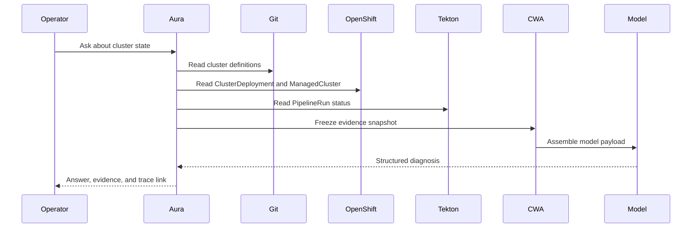

# Phase 1: Read-Only Assistant

## Status

Implemented, validated, and published at `01f0f38`, including closure hardening. Re-proved for the Phases 0–2 closure: every acceptance criterion is graded against tests at the current commit in [Phases 0 and 1 Acceptance](11-phase-0-1-acceptance.md#phase-1), and the live checks were re-run on 2026-10-26 ([Phase 1 Closure Re-run](../validation.md#phase-1-closure-re-run)). Closed: the operator signed off Phase 1 on 2026-10-26 in Stage 5 of the [closure plan](10-phase-0-2-closure.md), accepting every caveat. Open `fleet-clusters` data issues are tracked in [Open Questions](08-open-questions.md#fleet-clusters-data).

## Objective

Deliver the first Aura capability: explain current partner-labs state without side effects.

Phase 1 does not generate patches, start pipelines, or modify any repository.

## User Stories

1. As an operator, I can list active and archived cluster definitions.
2. As an operator, I can view a cluster's desired state from Git.
3. As an operator, I can view a cluster's actual state from OpenShift.
4. As an operator, I can inspect recent Tekton PipelineRuns.
5. As an operator, I can ask why a cluster appears stuck.
6. As an operator, I can see the evidence and CWA trace behind an answer.

## Required Views

### Cluster Inventory

| Field | Source |
| --- | --- |
| Cluster name | `fleet-clusters` |
| Tier | `fleet-clusters` |
| Cloud provider | `fleet-clusters` |
| Region | `fleet-clusters` |
| Desired state | Git |
| Actual state | OpenShift |
| Provisioning status | OpenShift |
| Latest pipeline run | Tekton |
| Drift indicator | Derived |

### Workflow View

| Field | Source |
| --- | --- |
| PipelineRun name | Tekton |
| Pipeline name | Tekton |
| Status | Tekton |
| Start and completion time | Tekton |
| Failed task | Tekton |
| Related cluster | Git and OpenShift |
| Next diagnostic step | Model proposal |

### Diagnosis View

The diagnosis must:

- Separate facts from inference.
- Cite the evidence used.
- Identify missing evidence.
- Explain likely causes.
- Propose a safe next inspection step.
- Avoid claiming certainty without evidence.

## Evidence Collection Flow

## Output Contract

The model must return strict JSON. The first response schema should contain:

| Field | Purpose |
| --- | --- |
| `summary` | Short operator-facing answer |
| `facts` | Deterministic observations used |
| `inferences` | Model explanations, marked as inference |
| `missing_evidence` | Data required for a stronger diagnosis |
| `recommended_inspection` | Read-only next step |
| `confidence` | Model confidence |
| `evidence_ids` | References to collector items |

No execution command is allowed in Phase 1.

## Acceptance Criteria

- [x] Aura lists cluster definitions without writing to Git.
- [x] Aura reads Git cluster definitions from committed `HEAD` and never from the working tree.
- [x] Aura lists OpenShift resources without write permissions.
- [x] Aura correlates Git, OpenShift, and Tekton data by cluster name.
- [x] Aura stores the frozen evidence snapshot.
- [x] Aura stores the CWA trace and snapshot digest.
- [x] Aura refuses to answer when required evidence is missing.
- [x] Aura returns schema-valid JSON from every model call.
- [x] Aura provides a deterministic fallback answer when the model is unavailable.
- [x] Aura suppresses completed idempotency keys before evidence collection.
- [x] Aura reports OpenShift CLI failures concisely without partial JSON.
- [x] Aura reports incomplete and invalid Git definitions per definition without aborting collection.
- [x] Aura correlates incomplete and invalid definitions by cluster name and does not report them as missing.
- [x] Aura never reports an incomplete PipelineRun as succeeded.
- [x] Aura authorizes only the roles an operator supplies.
- [x] Aura stores a terminal `failed` record when a record write fails.

## Validation Record

Recorded at Aura commit `6dc0eb3` against `fleet-clusters` commit `492bc8e07afddcd557441ddb7d72158de60ab8cb`. Procedures are in [Validation](../validation.md).

| Check | Result |
| --- | --- |
| Automated tests | `270 passed` with `uv run --no-sync pytest` |
| Diff hygiene | `git diff --check` passed |
| Quality gate | `ripwire . --quality-delta=adb2c2b..HEAD` reported zero gating findings |
| Git inventory | 26 definitions: 12 complete, 14 incomplete because `metadata.yaml` is absent, 0 invalid |
| Live OpenShift | Read-only service account listed 13 cluster states |
| Live Tekton | Read-only service account listed 34 PipelineRuns |
| Combined inventory | 25 records; no `missing-git` or `detected` drift |
| Workflow view | Correlated all 34 PipelineRuns to their `cluster-name` parameter |
| Immutable records | One evidence snapshot, one CWA snapshot, one CWA trace, and three linked audit events with matching digests |
| Live diagnosis | Diagnosed two clusters, each citing Git, OpenShift, and Tekton evidence |
| Refusals | One cluster refused for incomplete definition files, one for missing OpenShift and Tekton evidence, and one for conflicting definitions |
| Duplicate idempotency key | Rejected before collection with no new command record |
| Read-only RBAC | `list` allowed on all four resources; `create`, `patch`, and `delete` denied |
| Protected repositories | `fleet`, `fleet-cluster-scaffold`, `fleet-clusters`, and `portal` had no tracked modifications |
| Closure fixes | Commits `1f9877e` through `6dc0eb3` fixed role defaults, incomplete and invalid definition correlation, incomplete-metadata drift, incomplete PipelineRun reporting, record write failures, and redaction variants |

## Out of Scope

- Patch generation.
- PR creation.
- Pipeline execution.
- Deprovisioning.
- Portal writes.
- Legacy queue integration.

