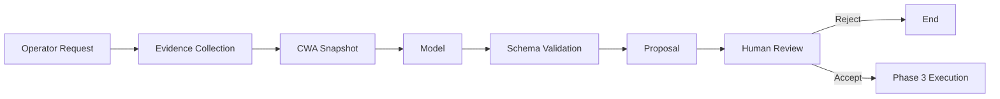

# Phase 2: Proposals

## Objective

Let Aura prepare reviewable changes without executing them.

Phase 2 generates:

- Cluster scaffold commands.
- Git patches.
- Deprovision plans.
- Tekton pipeline proposals.
- Human-readable explanations of expected effects.

No proposal is executed in Phase 2.

## Proposal Types

| Proposal | Input | Output |
| --- | --- | --- |
| New cluster scaffold | Operator request and cluster metadata | Scaffold command and generated files |
| Cluster patch | Existing Git state and requested change | Unified diff |
| Deprovision plan | Cluster inventory and lifecycle policy | Ordered action plan |
| Pipeline proposal | Cluster state and workflow need | Pipeline name, parameters, and expected result |
| Remediation proposal | Diagnosis and evidence | Next safe action |

## Proposal Flow

## Patch Boundary

Aura must produce patches before it is allowed to create PRs.

Patch requirements:

1. Base patch against a recorded Git commit.
2. Include only files relevant to the requested cluster.
3. Exclude secrets.
4. Include a human-readable explanation.
5. Include a rollback description.
6. Validate with repository-specific structural checks where possible.
7. Never apply the patch automatically in Phase 2.

## Scaffold Boundary

Aura invokes `fleet-cluster-scaffold` as a versioned external command.

The adapter must:

- Run in an isolated workspace.
- Pin the scaffold version.
- Capture stdout, stderr, exit code, and generated file list.
- Treat scaffold output as untrusted file data.
- Validate generated paths before exposing them to the operator.

Aura must not modify `fleet-cluster-scaffold`.

## Proposal Output Contract

Every proposal includes:

| Field | Purpose |
| --- | --- |
| `proposal_id` | Unique identifier |
| `command_id` | Originating command |
| `proposal_type` | Proposal family |
| `summary` | Operator-facing description |
| `expected_effect` | Intended outcome |
| `risks` | Known risks and side effects |
| `rollback` | Manual rollback approach |
| `patch` | Optional unified diff |
| `execution_plan` | Ordered adapter steps |
| `requires_approval` | Always true in Phase 2 |

## Acceptance Criteria

- Aura can generate a patch for a representative cluster change.
- Aura can generate a deprovision plan without executing it.
- Aura can propose a Tekton PipelineRun with parameters.
- Every proposal is schema-valid.
- Every proposal references its evidence snapshot and CWA trace.
- Every proposal includes risks and rollback.
- No protected repository is modified.
- No command executes without moving to Phase 3.

