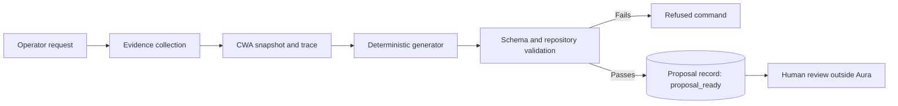

# Phase 2: Proposals

## Status

Approved on 2026-10-20. Prerequisites P0 and P1 are implemented and validated against the live hub, P3 and P4 are implemented, and P2 remains. The deprovision sentinel proposal type is implemented as `propose deprovision` and was validated against the live hub on 2026-10-23. The cluster-edit proposal type is implemented as `propose cluster-edit` and is not yet validated against the live hub. Revised after validation on 2026-10-20 against `fleet` commit `b8302da`, `fleet-clusters` commit `492bc8e07afddcd557441ddb7d72158de60ab8cb`, `fleet-cluster-scaffold` commit `e5346c3`, and the live hub. Implementation starts only after this plan is approved.

## Objective

Let Aura prepare reviewable, evidence-linked changes without executing them. A Phase 2 proposal never writes Git, never creates Kubernetes resources, and never starts a pipeline.

## Decisions

| Decision | Position |
| --- | --- |
| Proposal generator | Deterministic only. Artifacts come from the pinned scaffold, fixed templates, and evidence. Explanations, risks, and rollback text come from fixed templates. No model writes any part of a proposal. |
| CWA | Assembled for every proposal for traceability. The deterministic generator is recorded as provider `aura`, as in Phase 1. |
| Proposal types | New cluster scaffold, deprovision sentinel, post-provision rerun, and allow-listed existing-cluster edits |
| Pipeline definitions | Read from the live hub with the read-only service account |
| Scaffold execution | Pinned local `fleet-cluster-scaffold` checkout, run in a temporary workspace |
| External model | Not used in Phase 2 |

## Lifecycle Facts

Proposals must reflect how the existing systems act on Git. These behaviors were verified in the commits listed under Status:

| Event on `fleet-clusters` `main` | Effect |
| --- | --- |
| A push whose commits add any file under `provision/` | EventListener starts `pre-provision` for the first cluster name found, which chains into `provision` and then `post-provision`. |
| The push head commit message contains `[skip-provision]` | The pre-provision trigger is suppressed. Only the head commit message is checked. |
| A push whose commits add a file under `deprovision/` | EventListener starts `deprovision` for the first cluster name found, after stripping `-archive` from the file name. |
| `deprovision` succeeds | The pipeline creates a GitHub deployment status; the `archive-cluster` Action moves `provision/<id>` to `archive/<id>` and removes `deprovision/<id>-archive`. |
| The sentinel is `deprovision/<id>` without `-archive` | Deprovision runs, but the archive Action fails because it requires `deprovision/<id>-archive`. |
| A push that only modifies existing files | No pipeline runs. Argo CD syncs only `fleet/hub-config`, so nothing applies the change. |
| An HTTP body with `action: post-provision` sent to the EventListener | `post-provision` starts. This trigger has no webhook-secret interceptor. |

Re-verified on 2026-10-23 against `fleet` commit `9464f0b` and `fleet-clusters` commit `0453793`. The rows above still hold, and these also apply:

| Event | Effect |
| --- | --- |
| A pull request is opened or updated | No Tekton pipeline starts: the `pre-provision` and `deprovision` triggers accept only `push` events, and GitHub pull request payloads never carry `action: post-provision`. The `check-new-overlays` Action runs read-only and checks only cluster directories the pull request adds. |
| A push to any branch other than `main` | No pipeline starts; both push triggers require `refs/heads/main`. |
| A merge to `main` whose commits only modify existing files, by any merge method | No pipeline starts, because no commit adds a file. A merged pull request must contain only the proposal's change: any commit in it that adds a file under `provision/` or `deprovision/` triggers a pipeline. |

Disabling the webhook is not needed for modify-only changes, and it would drop every other push during the window.

Consequences:

1. Merging a `fleet-clusters` patch is the execution step. Phase 2 must state the trigger effect of every patch.
2. Every patch touches exactly one cluster, because only the first cluster name in a push triggers a pipeline.
3. A patch that adds files under an existing `provision/<id>` re-provisions that cluster unless it is pushed as a head commit containing `[skip-provision]`.
4. Pre-provision, provision, and deprovision runs are started only through Git. Aura does not propose PipelineRuns for them.

## Prerequisites

These must land before proposal types that depend on them:

| ID | Change | Needed by | Status |
| --- | --- | --- | --- |
| P0 | Git collector reads `deprovision/` sentinels, records whether each has the `-archive` suffix, and inventory and diagnosis distinguish pending, archive-pending, stranded, leftover, and orphaned deprovisions | Deprovision sentinel, inventory accuracy | Done |
| P1 | Tekton collector records redacted `spec.params` and workspace bindings, not only `cluster-name` | Post-provision rerun | Done |
| P2 | Read-only RBAC adds `list` on `pipelines.tekton.dev` in `openshift-pipelines`, and a collector reads Pipeline parameter definitions | Post-provision rerun | Open |
| P3 | Append-only proposal store and `Proposal` contract | All proposal types | Done |
| P4 | `propose` CLI commands, authorized for `proposer` and `admin` | All proposal types | Done |

At the validated commit, seven bare `deprovision/<id>` sentinels exist; six of those clusters still appear under `provision/` with no OpenShift resources, and only two still have a retained deprovision PipelineRun. With P0, Aura reports those six as `deprovision_status: stranded` and explains them in `diagnose state`, including the four without a retained PipelineRun. P1 records parameters with name-based redaction; `htpasswd-provider-name` is allowlisted because live validation showed it is the identity provider display name.

## Proposal Lifecycle

A proposal command follows the Phase 1 lifecycle and ends `succeeded` once its proposal record is stored. The proposal record carries its own status, starting at `proposal_ready`. Phase 3 adds approval records that move a proposal to `awaiting_approval`, `approved`, or `rejected`; Phase 2 never does.

## Proposal Types

### New Cluster Scaffold

| Aspect | Rule |
| --- | --- |
| Input | Cloud, cluster name, region, tier, topology, and optional scaffold flags |
| Preconditions | Name is a DNS-1123 label; no `provision/`, `archive/`, or `deprovision/` entry and no OpenShift resource uses the name; cloud is `aws` |
| Generation | Pinned scaffold, run with `--cluster-templates-dir` pointing at `cluster-templates/` exported from the base commit |
| Artifact | Patch that adds only `provision/<id>/**` |
| Validation | Scaffold `kustomize build` passes; applying the patch to the base commit and running `GitInventoryCollector` yields one complete `cluster_definition` whose `cluster_name` is `<id>` |
| Trigger effect | Merge starts pre-provision, provision, and post-provision |
| Commit message | Must not contain `[skip-provision]` |
| Reversibility | Before merge, discard. After merge, only a deprovision reverses it. |

### Deprovision Sentinel

| Aspect | Rule |
| --- | --- |
| Input | Cluster name |
| Preconditions | `provision/<id>` exists; no `archive/<id>`; no existing `deprovision/<id>` or `deprovision/<id>-archive`; no definition conflict; OpenShift resources exist |
| Artifact | Patch that adds the empty file `deprovision/<id>-archive` |
| Validation | Exactly one added file, and its name ends in `-archive` |
| Commit | A standalone commit that adds only `deprovision/<id>-archive`, with a message naming the cluster and stating that it requests deprovision. Remediation of a stranded cluster uses the same rule and says so in the message. |
| Trigger effect | Merge starts deprovision; success triggers the archive Action |
| Reversibility | Irreversible once the pipeline starts. Before merge, discard. |

### Post-Provision Rerun

| Aspect | Rule |
| --- | --- |
| Input | Cluster name and optional source PipelineRun |
| Preconditions | OpenShift `Provisioned` is `True`; a prior `post-provision` PipelineRun exists for the cluster; the source run is not running |
| Artifact | A PipelineRun manifest with `generateName`, copying the source run's redacted parameters and workspace bindings. It is not applied. |
| Validation | Every required Pipeline parameter is present, no unknown parameter is present, and values contain no secret material. Workspace secrets are referenced by name only. |
| Trigger effect | Phase 3 creates the PipelineRun through the Kubernetes API, never through the unauthenticated EventListener |
| Reversibility | Not reversible; post-provision tasks change the spoke cluster |

### Existing-Cluster Edits

| Aspect | Rule |
| --- | --- |
| Input | Cluster name and an allow-listed edit kind |
| Initial allow list | Backfill `metadata.yaml`, and backfill `platform` in an existing `metadata.yaml` |
| Values | Derived from evidence only: `platform` from the ClusterDeployment platform patch path, other keys from the latest post-provision PipelineRun parameters. A value with no evidence is not invented; the proposal is refused. |
| Artifact | Patch that touches only files under one `provision/<id>` |
| Validation | Applying the patch yields one complete `cluster_definition`, and combined inventory for the cluster no longer reports `incomplete-definition` or `incomplete-metadata` |
| Trigger effect | Adding a file re-triggers pre-provision unless the push head commit contains `[skip-provision]`. Modifying a file triggers nothing and applies nothing. |
| Commit message | Must contain `[skip-provision]` when the patch adds a file, and must be the push head commit |
| Reversibility | Revert the commit |

Scope decisions, revised 2026-10-23:

| Decision | Position |
| --- | --- |
| Edit kinds | Backfill a missing `metadata.yaml`, and add missing keys to an existing `metadata.yaml`, both under `provision/<id>` only. `metadata.yaml` stays a required definition file. |
| Keys | Every proposal leaves the file with all four keys below. Existing keys and any other keys are never changed. |
| Value sources | `platform` from the Git ClusterDeployment patch, cross-checked against the OpenShift ClusterDeployment. `htpasswd-provider-name` and `openshift-ai-version` from the latest retained `post-provision` PipelineRun parameters. Without that evidence, the `fleet` default below, which is what the pipeline uses today when the key is absent. |
| Run value differs from default | The run's value is written, because it is the spoke's current configuration. |
| `aws-credentials-mode` | The `legacy` default, because the pipeline treats a missing key as `legacy`. If evidence shows scoped credentials, such as a scoped Crossplane template, the proposal is refused. |
| Preconditions | Live OpenShift resources, no deprovision sentinel, exactly one definition, and it is under `provision/`. An existing key whose value contradicts evidence refuses the proposal. |
| Archived definitions | Never edited. |
| Provenance | The proposal states which keys came from evidence and which from `fleet` defaults, and the `fleet` commit the defaults were read from. |

The operator disabled the Tekton EventListener on 2026-10-23. Proposals still state trigger effects as if it were enabled, and a patch that adds `metadata.yaml` still requires `[skip-provision]` in the push head commit.

`metadata.yaml` keys read by `fleet` at commit `9464f0b`, with the value the pipeline uses when a key or the file is absent:

| Key | Default | Read by | Written by the scaffold at `2f6c7b4` |
| --- | --- | --- | --- |
| `platform` | `aws` | `read-cluster-metadata`, pre-provision branching | Always |
| `aws-credentials-mode` | `legacy` | Pre-provision credential workflow | `scoped` for new clusters, or `legacy` |
| `htpasswd-provider-name` | `htpasswd` | Post-provision OAuth configuration | Only when supplied |
| `openshift-ai-version` | `v3` | Post-provision AI workloads | Never |

Because an absent key means its default, writing a key whose value equals what the pipeline already uses changes no pipeline behavior. Writing a run's non-default value records the spoke's current configuration, so later pipeline runs keep it.

## Proposal Contract

| Field | Purpose |
| --- | --- |
| `proposal_id` | Unique identifier |
| `command_id` | Originating command |
| `proposal_type` | `scaffold`, `deprovision`, `post_provision_rerun`, or `cluster_edit` |
| `cluster_name` | The single target cluster |
| `status` | `proposal_ready` in Phase 2 |
| `base_commit` | `fleet-clusters` commit the patch applies to |
| `evidence_snapshot_id` and `evidence_snapshot_digest` | Evidence the proposal was derived from |
| `cwa_snapshot_id` and `cwa_trace_id` | CWA provenance |
| `generator` and `generator_version` | Deterministic generator, plus scaffold commit when used |
| `summary` | Operator-facing description |
| `expected_effect` | Intended outcome |
| `trigger_effect` | Pipelines or Actions that merging or applying will start, or `none` |
| `commit_message` | Required commit message, including `[skip-provision]` when needed |
| `risks` | Known risks and side effects |
| `reversibility` | `reversible`, `reversible_before_merge`, or `irreversible` |
| `rollback` | Manual rollback, or the point after which none exists |
| `patch` | Unified diff, for Git proposals |
| `pipeline_run` | PipelineRun manifest, for rerun proposals |
| `proposal_digest` | SHA-256 over canonical JSON of all fields above |

A proposal is stale when `fleet-clusters` `HEAD` moves past `base_commit` and touches the target cluster, or when its evidence no longer matches live state. Phase 2 reports staleness; Phase 3 refuses stale proposals.

## Scaffold Boundary

- Run `fleet-cluster-scaffold` from a local checkout at a recorded commit, not its package version.
- Run in a new temporary directory containing only an export of `fleet-clusters` at the base commit.
- Pass no credentials and no kubeconfig; the scaffold needs neither.
- Capture stdout, stderr, exit code, and the generated file list.
- Reject any generated path outside `provision/<id>/`, any symlink, and any file the redaction policy would alter.
- Require `kustomize` on the operator host; refuse when it is missing rather than passing `--skip-validation`.
- Never modify `fleet-cluster-scaffold`.

## Acceptance Criteria

- Each proposal type is generated for a representative cluster and is schema-valid.
- Every Git proposal applies cleanly to its `base_commit` with `git apply --check`.
- Every Git proposal touches exactly one cluster.
- Applying a scaffold or edit proposal to its base commit yields a complete `cluster_definition` for the target.
- Every proposal states its trigger effect, and tests cover each row of the lifecycle facts table.
- An edit proposal that adds a file under an existing `provision/<id>` always requires `[skip-provision]`.
- A deprovision proposal always uses the `-archive` suffix and is refused when any sentinel already exists.
- A post-provision rerun proposal is refused when a required parameter is missing or an unknown parameter is present.
- Every proposal references its evidence snapshot, CWA trace, and base commit, and carries a verified `proposal_digest`.
- Proposals contain no secret values.
- A stale proposal is reported as stale.
- No Git write, Kubernetes write, or pipeline start occurs.
- No protected repository is modified.

Failure-mode criteria, added on 2026-10-23 under the [development workflow](../development.md):

- Each contract rule that says only, exactly, or empty is enforced by the `Proposal` contract itself and has a negative test against it; for example, a deprovision patch that adds a non-empty or non-regular sentinel is rejected.
- A proposal file is written only after its CWA trace and `proposal_created` audit event; a failure at any earlier write leaves no proposal file.
- Every `propose` and `proposal` command that fails after the idempotency check stores a `failed` terminal record, and `command_failed` links to the last audit event stored.
- `proposal status` fails, rather than reporting no proposals, when the proposal store is missing or unreadable or a record is misnamed, unreadable, or tampered.
- Each proposal type has failure tests for every row of its failure-mode matrix.

The deprovision and cluster-edit types and `proposal status` meet these criteria; the shared failure-injection harness covers every row of their matrices, including refusal.

## Out of Scope

- Model-generated proposals or explanations.
- PipelineRun proposals for pre-provision, provision, or deprovision.
- Remediation proposals; `diagnose state` keeps providing read-only next steps.
- Applying patches, creating branches, or opening pull requests.
- Approval records.
- Azure, GCP, and IBM Cloud scaffolds.

## Phase 3 Impact

Approval of this plan requires these changes to [Phase 3](06-phase-3-approved-execution.md) before it is implemented:

- The Git adapter is the execution path for scaffold, deprovision, and edit proposals, and it must push the proposal as the head commit with the required message.
- The Tekton adapter is limited to post-provision reruns, created through the Kubernetes API.
- The guard refuses stale proposals and proposals whose `proposal_digest` changed.

## Open Questions

1. How should stranded clusters with bare sentinels be remediated? Re-adding a `-archive` sentinel re-runs deprovision against already-removed resources, and whether that pipeline is idempotent is unverified.
2. Should the `fleet-clusters` README be corrected to document `deprovision/<id>-archive`? Aura cannot change it.
3. The post-provision EventListener trigger accepts unauthenticated requests. This belongs to `fleet`, but Phase 3 must not depend on it.
4. Which further edit kinds belong on the allow list once their apply path is known?
