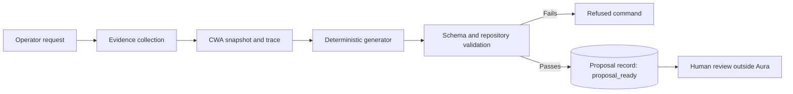

# Phase 2: Proposals

## Status

Approved on 2026-10-20. Prerequisites P0 and P1 are implemented and validated against the live hub, P3 and P4 are implemented, and P2 is implemented and validated against the live hub. The deprovision sentinel proposal type is implemented as `propose deprovision` and was validated against the live hub on 2026-10-23. The cluster-edit proposal type is implemented as `propose cluster-edit` and was validated against the live hub on 2026-10-24. The post-provision rerun type is implemented as `propose post-provision-rerun` and was validated against the live hub on 2026-10-25. The scaffold type is implemented as `propose scaffold` and was validated against the live hub on 2026-10-25; its rules were revised the same day after re-verification against `fleet-cluster-scaffold` commit `2f6c7b4`, `fleet-clusters` commit `4ead929`, and `fleet` commit `9464f0b`. Revised after validation on 2026-10-20 against `fleet` commit `b8302da`, `fleet-clusters` commit `492bc8e07afddcd557441ddb7d72158de60ab8cb`, `fleet-cluster-scaffold` commit `e5346c3`, and the live hub. Implementation starts only after this plan is approved.

## Objective

Let Aura prepare reviewable, evidence-linked changes without executing them. A Phase 2 proposal never writes Git, never creates Kubernetes resources, and never starts a pipeline.

## Decisions

| Decision | Position |
| --- | --- |
| Proposal generator | Deterministic only. Artifacts come from the pinned scaffold, fixed templates, and evidence. Explanations, risks, and rollback text come from fixed templates. No model writes any part of a proposal. |
| CWA | Assembled for every proposal for traceability. The deterministic generator is recorded as provider `aura`, as in Phase 1. |
| Proposal types | New cluster scaffold, deprovision sentinel, post-provision rerun, and allow-listed existing-cluster edits |
| Pipeline definitions | Read from the live hub with the read-only service account |
| Scaffold execution | Pinned local `fleet-cluster-scaffold` checkout, run in a temporary workspace |
| External model | Not used in Phase 2 |

## Lifecycle Facts

Proposals must reflect how the existing systems act on Git. These behaviors were verified in the commits listed under Status:

| Event on `fleet-clusters` `main` | Effect |
| --- | --- |
| A push whose commits add any file under `provision/` | EventListener starts `pre-provision` for the first cluster name found, which chains into `provision` and then `post-provision`. |
| The push head commit message contains `[skip-provision]` | The pre-provision trigger is suppressed. Only the head commit message is checked. |
| A push whose commits add a file under `deprovision/` | EventListener starts `deprovision` for the first cluster name found, after stripping `-archive` from the file name. |
| `deprovision` succeeds | The pipeline creates a GitHub deployment status; the `archive-cluster` Action moves `provision/<id>` to `archive/<id>` and removes `deprovision/<id>-archive`. |
| The sentinel is `deprovision/<id>` without `-archive` | Deprovision runs, but the archive Action fails because it requires `deprovision/<id>-archive`. |
| A push that only modifies existing files | No pipeline runs. Argo CD syncs only `fleet/hub-config`, so nothing applies the change. |
| An HTTP body with `action: post-provision` sent to the EventListener | `post-provision` starts. This trigger has no webhook-secret interceptor. |

Re-verified on 2026-10-23 against `fleet` commit `9464f0b` and `fleet-clusters` commit `0453793`. The rows above still hold, and these also apply:

| Event | Effect |
| --- | --- |
| A pull request is opened or updated | No Tekton pipeline starts: the `pre-provision` and `deprovision` triggers accept only `push` events, and GitHub pull request payloads never carry `action: post-provision`. The `check-new-overlays` Action runs read-only and checks only cluster directories the pull request adds. |
| A push to any branch other than `main` | No pipeline starts; both push triggers require `refs/heads/main`. |
| A merge to `main` whose commits only modify existing files, by any merge method | No pipeline starts, because no commit adds a file. A merged pull request must contain only the proposal's change: any commit in it that adds a file under `provision/` or `deprovision/` triggers a pipeline. |

Disabling the webhook is not needed for modify-only changes, and it would drop every other push during the window.

Consequences:

1. Merging a `fleet-clusters` patch is the execution step. Phase 2 must state the trigger effect of every patch.
2. Every patch touches exactly one cluster, because only the first cluster name in a push triggers a pipeline.
3. A patch that adds files under an existing `provision/<id>` re-provisions that cluster unless it is pushed as a head commit containing `[skip-provision]`.
4. Pre-provision, provision, and deprovision runs are started only through Git. Aura does not propose PipelineRuns for them.

## Prerequisites

These must land before proposal types that depend on them:

| ID | Change | Needed by | Status |
| --- | --- | --- | --- |
| P0 | Git collector reads `deprovision/` sentinels, records whether each has the `-archive` suffix, and inventory and diagnosis distinguish pending, archive-pending, stranded, leftover, and orphaned deprovisions | Deprovision sentinel, inventory accuracy | Done |
| P1 | Tekton collector records redacted `spec.params` and workspace bindings, not only `cluster-name` | Post-provision rerun | Done |
| P2 | Read-only RBAC adds `list` on `pipelines.tekton.dev` in `openshift-pipelines`, and a collector reads Pipeline parameter definitions | Post-provision rerun | Done; `deploy/` applied and validated on 2026-10-24 |
| P3 | Append-only proposal store and `Proposal` contract | All proposal types | Done |
| P4 | `propose` CLI commands, authorized for `proposer` and `admin` | All proposal types | Done |

At the validated commit, seven bare `deprovision/<id>` sentinels exist; six of those clusters still appear under `provision/` with no OpenShift resources, and only two still have a retained deprovision PipelineRun. With P0, Aura reports those six as `deprovision_status: stranded` and explains them in `diagnose state`, including the four without a retained PipelineRun. P1 records parameters with name-based redaction; `htpasswd-provider-name` is allowlisted because live validation showed it is the identity provider display name.

## Proposal Lifecycle

A proposal command follows the Phase 1 lifecycle and ends `succeeded` once its proposal record is stored. The proposal record carries its own status, starting at `proposal_ready`. Phase 3 adds approval records that move a proposal to `awaiting_approval`, `approved`, or `rejected`; Phase 2 never does.

## Proposal Types

### New Cluster Scaffold

| Aspect | Rule |
| --- | --- |
| Input | Cloud, cluster name, region, tier, and the allow-listed scaffold flags below |
| Preconditions | Cloud is `aws`; name is a DNS-1123 label of at most 49 characters; no `provision/`, `archive/`, or `deprovision/` entry (with or without `-archive`) and no OpenShift ClusterDeployment or ManagedCluster uses the name or shares its infra prefix; `kustomize` is on `PATH`; the scaffold checkout is a clean Git checkout |
| Generation | Pinned scaffold, exported from its Git objects and run in a temporary workspace holding an export of `fleet-clusters` at the base commit, with `--base-path provision --cluster-templates-dir cluster-templates` |
| Artifact | Patch that adds only regular files (mode `100644`) under `provision/<id>/`, including every required definition file |
| Validation | Scaffold `kustomize build` passes; the generated overlay passes Aura's re-implementation of the `fleet-clusters` new-overlay PR check; applying the patch to the base commit and running `GitInventoryCollector` yields one complete `cluster_definition` whose `cluster_name` is `<id>` |
| Trigger effect | Merge starts pre-provision, provision, and post-provision |
| Commit message | Must not contain `[skip-provision]` |
| Reversibility | Before merge, discard. After merge, only a deprovision reverses it. |

Facts at `fleet-cluster-scaffold` `2f6c7b4`, verified 2026-10-25 by running a `git archive` export in a scratch workspace:

| Fact | Consequence |
| --- | --- |
| Entry point `scaffold.cli:main(args)`; only `aws` is usable | Aura passes `aws` and refuses other clouds |
| Output is `<--base-path>/<name>/`; base references are relative paths from `--base-path` to `--cluster-templates-dir` | Run inside the `fleet-clusters` export with `--base-path provision --cluster-templates-dir cluster-templates`, which yields the `../../../cluster-templates/aws/<topology>/...` paths committed definitions use |
| AWS `cluster-templates/` are byte-identical in the scaffold and `fleet-clusters` `4ead929` | The `fleet-clusters` templates at the base commit are authoritative |
| Default output is scoped AWS: `metadata.yaml` with `platform: aws` and `aws-credentials-mode: scoped`, and `htpasswd-provider-name` only when supplied; never `openshift-ai-version` | Accepted unmodified: absent keys take `fleet` defaults, and `openshift-ai-version` applies only to `ai` clusters, whose default is `v3` |
| Output is deterministic, contains no secret material and no symlinks; regenerating a committed scoped definition with its parameters reproduces it | Same inputs give the same patch |
| Scoped names longer than 49 characters exit 1 (IAM `<name>-<operator>` ≤ 64) | Aura checks the limit first and refuses with a structured reason |
| With `kustomize` missing, the overlay is written first, then the run exits 1 | Aura checks `kustomize` before running and discards the workspace on any non-zero exit |
| Logs go to standard error; standard output is empty; argument errors exit 2 | Both streams are captured |
| No network, credentials, or kubeconfig; the only subprocess is `kustomize` | Run with a minimal environment |

The `fleet-clusters` PR check `scripts/check_new_overlays.py` rejects a new overlay with non-scoped AWS metadata, a name over 49 characters, an old wildcard render or a missing current `machine-api` pattern, a failed `kustomize build` or surviving `cluster-placeholder` names, or an infra prefix shared with any `provision/` or `archive/` directory. The `fleet` pre-provision task `check-prefix-collision` also scans `deprovision/`, hub ClusterDeployments and ManagedClusters, and Crossplane IAM labels, and it ignores `oc` failures. The infra prefix replaces characters outside `[A-Za-z0-9-]` with `-`, collapses repeated `-`, keeps 21 characters, and strips trailing `-`.

Decisions, 2026-10-25:

| Decision | Position |
| --- | --- |
| Infra prefix | Refuse when any name in `provision/`, `archive/`, or `deprovision/` (stripping `-archive`), or any OpenShift ClusterDeployment or ManagedCluster, shares the infra prefix. Crossplane IAM labels are not read: that needs a new `list` grant, and `fleet` checks them before provisioning |
| Scaffold flags | The operator may pass `--topology`, `--environment`, `--base-domain`, `--control-plane-type`, `--worker-type`, `--control-plane-replicas`, `--worker-replicas`, `--image-set`, `--zones`, `--install-attempts-limit`, and `--htpasswd-provider-name`. Aura alone sets `--name`, `--region`, `--tier`, `--base-path`, and `--cluster-templates-dir` from its own inputs. `--force`, `--skip-validation`, and `--legacy-mint-credentials` are never passed |
| `metadata.yaml` | Scaffold output is accepted unmodified |
| PR check | Aura re-implements its rules, with a parity test for the infra prefix, instead of executing `fleet-clusters` code |
| Run record | Scaffold proposals carry a `scaffold_run` record: the `kustomize` version, the scaffold arguments, the exit code, standard output and error, and the generated file list |
| Pinning | `--scaffold <path>` names a local checkout; Aura records its `HEAD` as `scaffold_commit`, refuses a dirty tracked tree, and runs an export of that commit written from `git ls-tree` and `git cat-file`, which export attributes cannot alter |

Contract rules for scaffold proposals:

- `scaffold_commit` and `scaffold_run` are present on scaffold proposals and absent on every other type.
- `scaffold_run.exit_code` is exactly `0`.
- `scaffold_run.files` equals exactly the paths the patch adds.
- `scaffold_run.arguments` start with `aws`, carry `--name <id>`, `--base-path provision`, and `--cluster-templates-dir cluster-templates`, use only the flags above, each at most once and each with a value, and never `--force`, `--skip-validation`, or `--legacy-mint-credentials`.
- The patch adds only regular files with mode `100644`; never a symlink or an executable file.
- The patch adds every required definition file: `crossplane/kustomization.yaml`, `hive/patches/clusterdeployment.yaml`, `hive/patches/managedcluster.yaml`, and `metadata.yaml`.
- The added `metadata.yaml` declares `platform: aws` and `aws-credentials-mode: scoped`.
- `cluster_name` is at most 49 characters.

### Deprovision Sentinel

| Aspect | Rule |
| --- | --- |
| Input | Cluster name |
| Preconditions | `provision/<id>` exists; no `archive/<id>`; no existing `deprovision/<id>` or `deprovision/<id>-archive`; no definition conflict; OpenShift resources exist |
| Artifact | Patch that adds the empty file `deprovision/<id>-archive` |
| Validation | Exactly one added file, and its name ends in `-archive` |
| Commit | A standalone commit that adds only `deprovision/<id>-archive`, with a message naming the cluster and stating that it requests deprovision. Remediation of a stranded cluster uses the same rule and says so in the message. |
| Trigger effect | Merge starts deprovision; success triggers the archive Action |
| Reversibility | Irreversible once the pipeline starts. Before merge, discard. |

### Post-Provision Rerun

| Aspect | Rule |
| --- | --- |
| Input | Cluster name and optional source PipelineRun |
| Preconditions | OpenShift `Provisioned` is `True`; a prior `post-provision` PipelineRun exists for the cluster; the source run is not running |
| Artifact | A PipelineRun manifest with `generateName`, copying the source run's redacted parameters and workspace bindings. It is not applied. |
| Validation | Every required Pipeline parameter is present, no unknown parameter is present, and values contain no secret material. Workspace secrets are referenced by name only. |
| Trigger effect | Phase 3 creates the PipelineRun through the Kubernetes API, never through the unauthenticated EventListener |
| Reversibility | Not reversible; post-provision tasks change the spoke cluster |

Decisions, 2026-10-24:

| Decision | Position |
| --- | --- |
| Source run | `--pipeline-run` names one; otherwise the latest `post-provision` PipelineRun for the cluster. A source run that has not finished refuses the proposal, because a rerun would overlap it. |
| Run template | Copied from the source run: `taskRunTemplate.serviceAccountName` and the supported `podTemplate` fields. The Tekton collector records them; any other `taskRunTemplate` or `podTemplate` field refuses the proposal. |
| Parameters | Copied from the source run and checked against the live `post-provision` Pipeline definition. For `htpasswd-provider-name`, and for `openshift-ai-version` only when the source run's `tier` parameter is `ai`, the value the rerun would use, copied or the Pipeline default, must equal the value `metadata.yaml` declares or defaults to; otherwise the proposal is refused. Revised 2026-10-25: `apply-ai-workloads`, the only reader of `openshift-ai-version`, runs only when `tier` is `ai`, so the key cannot affect any other rerun. |
| Workspace Secrets | Allowed only as a `secret` binding holding `secretName` and optional `items`; secret material anywhere else is still rejected. |

Facts at `fleet` `9464f0b`: both the provision pipeline's `trigger-post-provision` task and the EventListener template create `post-provision` runs with `taskRunTemplate.serviceAccountName: fleet-pipeline`, a pod template with `fsGroup: 0` and the `fleet-pipeline-pull-secret` image pull secret, and a `shared-workspace` `volumeClaimTemplate`. The trigger task passes five parameters; the EventListener passes only `cluster-name`, `tier`, and `dns-zones`, so its runs take the Pipeline defaults for `htpasswd-provider-name` (`htpasswd`) and `openshift-ai-version` (`v3`).

### Existing-Cluster Edits

| Aspect | Rule |
| --- | --- |
| Input | Cluster name and an allow-listed edit kind |
| Initial allow list | Backfill `metadata.yaml`, and backfill `platform` in an existing `metadata.yaml` |
| Values | Derived from evidence only: `platform` from the ClusterDeployment platform patch path, other keys from the latest post-provision PipelineRun parameters. A value with no evidence is not invented; the proposal is refused. |
| Artifact | Patch that touches only files under one `provision/<id>` |
| Validation | Applying the patch yields one complete `cluster_definition`, and combined inventory for the cluster no longer reports `incomplete-definition` or `incomplete-metadata` |
| Trigger effect | Adding a file re-triggers pre-provision unless the push head commit contains `[skip-provision]`. Modifying a file triggers nothing and applies nothing. |
| Commit message | Must contain `[skip-provision]` when the patch adds a file, and must be the push head commit |
| Reversibility | Revert the commit |

Scope decisions, revised 2026-10-23:

| Decision | Position |
| --- | --- |
| Edit kinds | Backfill a missing `metadata.yaml`, and add missing keys to an existing `metadata.yaml`, both under `provision/<id>` only. `metadata.yaml` stays a required definition file. |
| Keys | Every proposal leaves the file with every key below that applies to the cluster's tier: `platform`, `aws-credentials-mode`, and `htpasswd-provider-name` always, and `openshift-ai-version` only when the tier is `ai`. A proposal never adds `openshift-ai-version` for another tier. Existing keys and any other keys are never changed. The `Proposal` contract requires the three tier-independent keys; it carries no tier, so the generator enforces the `openshift-ai-version` rule from evidence. Revised 2026-10-25; previously all four keys for every tier. |
| Tier | From the Git ManagedCluster patch `/metadata/labels/tier`, cross-checked against the OpenShift ManagedCluster `tier` label; a disagreement refuses the proposal. |
| Value sources | `platform` from the Git ClusterDeployment patch, cross-checked against the OpenShift ClusterDeployment. `htpasswd-provider-name`, and `openshift-ai-version` for an `ai` cluster, from the latest retained `post-provision` PipelineRun parameters; `openshift-ai-version` only from a run whose `tier` parameter is `ai`, since no other run applied it. Without that evidence, the `fleet` default below, which is what the pipeline uses today when the key is absent. For a cluster of another tier, an existing `openshift-ai-version` is not compared with the run, because no task reads it. |
| Run value differs from default | The run's value is written, because it is the spoke's current configuration. |
| `aws-credentials-mode` | The `legacy` default, because the pipeline treats a missing key as `legacy`. If evidence shows scoped credentials, such as a scoped Crossplane template, the proposal is refused. |
| Preconditions | Live OpenShift resources, no deprovision sentinel, exactly one definition, and it is under `provision/`. An existing key whose value contradicts evidence refuses the proposal. |
| Archived definitions | Never edited. |
| Provenance | The proposal states which keys came from evidence and which from `fleet` defaults, and the `fleet` commit the defaults were read from. |

The operator disabled the Tekton EventListener on 2026-10-23. Proposals still state trigger effects as if it were enabled, and a patch that adds `metadata.yaml` still requires `[skip-provision]` in the push head commit.

`metadata.yaml` keys read by `fleet` at commit `9464f0b`, with the value the pipeline uses when a key or the file is absent:

| Key | Default | Read by | Written by the scaffold at `2f6c7b4` |
| --- | --- | --- | --- |
| `platform` | `aws` | Written as a `read-cluster-metadata` result; no task reads it | Always |
| `aws-credentials-mode` | `legacy` | Pre-provision credential workflow | `scoped` for new clusters, or `legacy` |
| `htpasswd-provider-name` | `htpasswd` | Post-provision OAuth configuration | Only when supplied |
| `openshift-ai-version` | `v3` | Post-provision `apply-ai-workloads`, which runs only when `tier` is `ai` | Never |

Of these keys, only `openshift-ai-version` depends on tier. `htpasswd-provider-name` is read by `configure-spoke-oauth` for every OpenShift cluster, and `aws-credentials-mode` gates the pre-provision and provision credential steps for every AWS cluster.

Because an absent key means its default, writing a key whose value equals what the pipeline already uses changes no pipeline behavior. Writing a run's non-default value records the spoke's current configuration, so later pipeline runs keep it.

## Proposal Contract

| Field | Purpose |
| --- | --- |
| `proposal_id` | Unique identifier |
| `command_id` | Originating command |
| `proposal_type` | `scaffold`, `deprovision`, `post_provision_rerun`, or `cluster_edit` |
| `cluster_name` | The single target cluster |
| `status` | `proposal_ready` in Phase 2 |
| `base_commit` | `fleet-clusters` commit the patch applies to; for a rerun, the commit whose `metadata.yaml` and definition its evidence read. Required for every type (decided 2026-10-25, implemented in `8193210`) |
| `evidence_snapshot_id` and `evidence_snapshot_digest` | Evidence the proposal was derived from |
| `cwa_snapshot_id` and `cwa_trace_id` | CWA provenance |
| `generator` and `generator_version` | Deterministic generator |
| `scaffold_commit` and `scaffold_run` | Scaffold commit and run record, for scaffold proposals only |
| `summary` | Operator-facing description |
| `expected_effect` | Intended outcome |
| `trigger_effect` | Pipelines or Actions that merging or applying will start, or `none` |
| `commit_message` | Required commit message, including `[skip-provision]` when needed |
| `risks` | Known risks and side effects |
| `reversibility` | `reversible`, `reversible_before_merge`, or `irreversible` |
| `rollback` | Manual rollback, or the point after which none exists |
| `patch` | Unified diff, for Git proposals |
| `pipeline_run` | PipelineRun manifest, for rerun proposals |
| `proposal_digest` | SHA-256 over canonical JSON of all fields above |

A proposal is stale when `fleet-clusters` `HEAD` moves past `base_commit` and touches the target cluster's paths. Phase 2 reports this Git staleness for every type, reruns included. Live state is not compared in Phase 2: decided 2026-10-25, the Phase 3 execution guard re-collects evidence immediately before executing and refuses when the regenerated proposal's digest differs from the approved one, because a live check at status time would itself be out of date by execution time.

## Scaffold Boundary

- Run `fleet-cluster-scaffold` from an export of a clean local checkout, written from its Git objects, at a recorded commit, not its package version, so nothing is written into the checkout.
- Run in a new temporary directory containing only an export of `fleet-clusters` at the base commit.
- Pass no credentials and no kubeconfig; the scaffold needs neither.
- Capture stdout, stderr, exit code, and the generated file list.
- Reject any generated path outside `provision/<id>/`, any symlink, and any file the redaction policy would alter.
- Require `kustomize` on the operator host; refuse when it is missing rather than passing `--skip-validation`.
- Never modify `fleet-cluster-scaffold`.

## Acceptance Criteria

- Each proposal type is generated for a representative cluster and is schema-valid.
- Every Git proposal applies cleanly to its `base_commit` with `git apply --check`.
- Every Git proposal touches exactly one cluster.
- Applying a scaffold or edit proposal to its base commit yields a complete `cluster_definition` for the target.
- Every proposal states its trigger effect, and tests cover each row of the lifecycle facts table.
- An edit proposal that adds a file under an existing `provision/<id>` always requires `[skip-provision]`.
- A deprovision proposal always uses the `-archive` suffix and is refused when any sentinel already exists.
- A post-provision rerun proposal is refused when a required parameter is missing or an unknown parameter is present.
- Every proposal references its evidence snapshot, CWA trace, and base commit, and carries a verified `proposal_digest`.
- Proposals contain no secret values.
- A proposal whose target cluster's `fleet-clusters` paths changed after its `base_commit` is reported as stale. Revised 2026-10-25 from "a stale proposal is reported as stale": live-state staleness is a Phase 3 guard.
- No Git write, Kubernetes write, or pipeline start occurs.
- No protected repository is modified.

Failure-mode criteria, added on 2026-10-23 under the [development workflow](../development.md):

- Each contract rule that says only, exactly, or empty is enforced by the `Proposal` contract itself and has a negative test against it; for example, a deprovision patch that adds a non-empty or non-regular sentinel is rejected.
- A proposal file is written only after its CWA trace and `proposal_created` audit event; a failure at any earlier write leaves no proposal file.
- Every `propose` and `proposal` command that fails after the idempotency check stores a `failed` terminal record, and `command_failed` links to the last audit event stored.
- `proposal status` fails, rather than reporting no proposals, when the proposal store is missing or unreadable or a record is misnamed, unreadable, or tampered.
- Each proposal type has failure tests for every row of its failure-mode matrix.

The deprovision and cluster-edit types and `proposal status` meet these criteria; the shared failure-injection harness covers every row of their matrices, including refusal.

## Out of Scope

- Model-generated proposals or explanations.
- PipelineRun proposals for pre-provision, provision, or deprovision.
- Remediation proposals; `diagnose state` keeps providing read-only next steps.
- Applying patches, creating branches, or opening pull requests.
- Approval records.
- Azure, GCP, and IBM Cloud scaffolds.

## Phase 3 Impact

Approval of this plan requires these changes to [Phase 3](06-phase-3-approved-execution.md) before it is implemented:

- The Git adapter is the execution path for scaffold, deprovision, and edit proposals, and it must push the proposal as the head commit with the required message.
- The Tekton adapter is limited to post-provision reruns, created through the Kubernetes API.
- The guard refuses stale proposals and proposals whose `proposal_digest` changed.
- The guard re-collects evidence immediately before executing, regenerates the proposal, and refuses when the regenerated action differs from the approved one. This is where live-state staleness is enforced. The comparison covers a defined action subset, not the full `proposal_digest`, because the digest also covers fields that always change on regeneration, such as `proposal_id`, `command_id`, `created_at`, the evidence and CWA references, and a rerun's `base_commit`. The subset is at least the proposal type, cluster, trigger effect, and the patch or the PipelineRun manifest without Aura's annotations; Phase 3 defines it exactly.
- The guard checks a stored proposal's digest against the `proposal_created` audit event or the CWA trace's `response_digest`, not only against itself.

## Open Questions

1. How should stranded clusters with bare sentinels be remediated? Re-adding a `-archive` sentinel re-runs deprovision against already-removed resources, and whether that pipeline is idempotent is unverified.
2. Should the `fleet-clusters` README be corrected to document `deprovision/<id>-archive`? Aura cannot change it.
3. The post-provision EventListener trigger accepts unauthenticated requests. This belongs to `fleet`, but Phase 3 must not depend on it.
4. Which further edit kinds belong on the allow list once their apply path is known?
