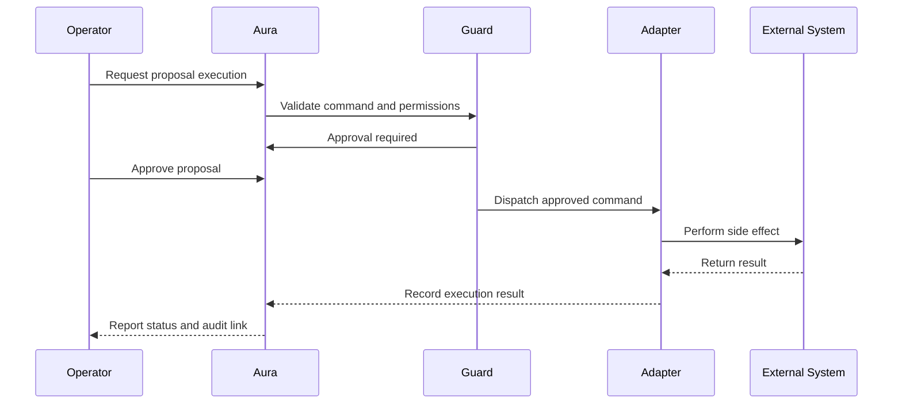
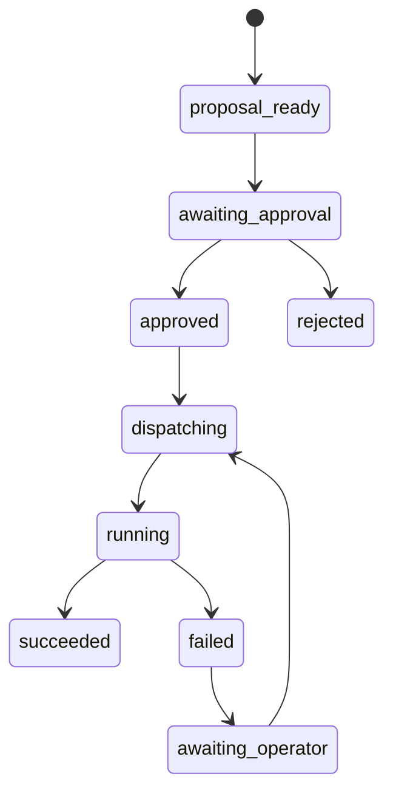

# Phase 3: Approved Execution

## Objective

Execute narrowly scoped, human-approved actions through guarded adapters.

Phase 3 is not autonomous operation. Every execution requires an explicit approval.

## Execution Scope

Initial approved actions:

1. Apply or submit a previously reviewed Git patch.
2. Start a previously reviewed Tekton PipelineRun.
3. Monitor an execution and record its result.

Deferred actions:

1. Deprovision without human approval.
2. Retry automatically.
3. Modify protected repository code.
4. Write Portal's database.
5. Bypass the Command Guard.

## Approval Flow

## Guard Requirements

Before dispatch, the guard must verify:

1. Proposal is in `awaiting_approval`.
2. Operator is authorized for the command type.
3. Approver is authorized to approve.
4. Target scope is allowed.
5. Proposal and evidence snapshot digests are unchanged.
6. Idempotency key has not succeeded already.
7. Adapter is allow-listed.
8. Required external system is reachable.

If any check fails, execution is rejected and recorded.

## Git Adapter

The Git adapter may:

- Create a local branch.
- Apply a reviewed patch.
- Commit the patch.
- Open a pull request.

The Git adapter must not:

- Push directly to a protected branch.
- Modify repository code unrelated to the proposal.
- Include secret values.
- Force push.

If `fleet-clusters` must remain completely unchanged, the adapter stops at patch generation and returns the patch to the operator.

## Tekton Adapter

The Tekton adapter may:

- Start an approved PipelineRun.
- Poll PipelineRun status.
- Fetch non-secret task logs.
- Record success or failure.

The Tekton adapter must not:

- Create or modify Pipeline definitions in `fleet`.
- Treat the model as the workflow engine.
- Retry automatically in Phase 3.

## Execution States

## Audit Record

Every execution records:

- Command ID.
- Proposal ID.
- Evidence snapshot digest.
- CWA trace ID.
- Operator and approver identities.
- Approval time.
- Adapter name and version.
- Input parameters, redacted.
- External result.
- Failure reason, if any.
- Rollback instruction.

## Acceptance Criteria

- A read-only command cannot be dispatched as an execution command.
- An unapproved proposal cannot execute.
- A modified proposal cannot execute under an old approval.
- A duplicate idempotency key does not execute twice.
- Git and Tekton adapters run with separate least-privilege credentials.
- Every execution produces an immutable audit event.
- A failed execution records enough information for manual recovery.
- Protected repository code remains unchanged.

