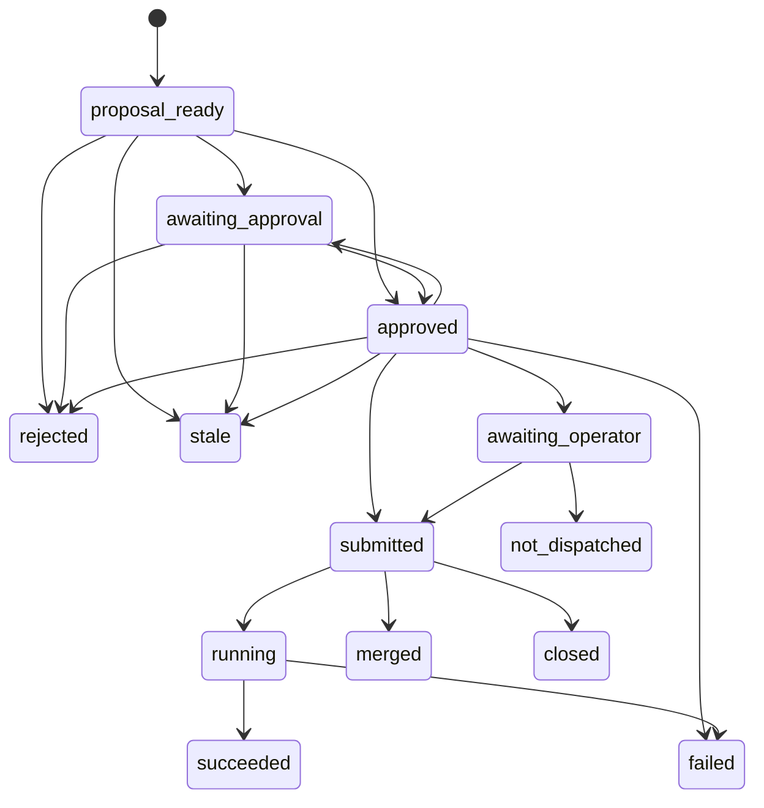

# Phase 3: Approved Execution

## Status

Revised 2026-10-27; replaces the draft aligned on 2026-10-20. The [Operator Decisions](#operator-decisions) D7–D13 were recorded on 2026-10-27; the plan awaits the operator's approval. Phases 0–2 were signed off on 2026-10-26. Stage 3 closes the [Phase 3 Entry Conditions](10-phase-0-2-closure.md#phase-3-entry-conditions) E2–E4 before any adapter writes to an external system. E1 stays bound to connecting an external model, which this plan does not do.

## Objective

Execute one human-approved Phase 2 proposal at a time through a guarded adapter, and record every step.

Phase 3 is not autonomous operation. Every execution requires an explicit approval of one unchanged proposal.

## Rules

The closure plan's [rules](10-phase-0-2-closure.md#rules) R2–R6 apply, reading "closure criterion" as a Phase 3 [acceptance criterion](#acceptance-criteria). Reviews use this plan's [Review Brief](#review-brief). The closure plan's [Session Guardrails](10-phase-0-2-closure.md#session-guardrails) apply, except that Stage 4 live runs use `~/.kube/aura-executor` against the staging hub and the staging PostgreSQL through Aura's insert-only role, and first confirm the identities and grants that task 4.4 lists. In addition:

| Rule | Statement |
| --- | --- |
| P3-1 Frozen scope | Phase 3 is the [acceptance criteria](#acceptance-criteria) and the stage tasks below. Only an operator decision recorded in this plan changes them. |
| P3-2 No write before the guard | Stages 1–3 make no external write. An adapter that writes to Git or Kubernetes is built only in Stages 4–5, after the guard's acceptance criteria pass. |
| P3-3 Record around every write | An adapter's write method is called only after its `dispatching` execution record is stored, and its result is stored after the call returns. |
| P3-4 Prerequisites before a stage | A stage that needs a decision, a credential, or a staging system starts only after the operator has provided it. Tests use fakes; every live run needs the operator's approval. |
| P3-5 Bounded review | One independent review per stage, using the [Review Brief](#review-brief). |
| P3-6 Stop rule | Phase 3 is closed when every acceptance criterion is met or met with an operator-accepted caveat, and the Stage 6 review reports no violation. |

## Operator Decisions

Recorded on 2026-10-27: the operator accepted every recommendation, so each row's Recommendation is its decision. D13 was added the same day, when the operator stated that Aura will have a database. A stage that depends on a prerequisite a decision names, such as the staging hub, a credential, or a database, does not start until the operator provides it. IDs continue from the closure plan's D1–D6.

| ID | Question | Options | Recommendation | Blocks |
| --- | --- | --- | --- | --- |
| D7 | How does the guard know who an operator is? `--operator` and `--role` are self-asserted today, so any user can claim `approver` ([Identity and Authorization](08-open-questions.md#identity-and-authorization)) | (a) A local role file read by the CLI; (b) the caller's OpenShift identity and group membership; (c) SSH signatures (`ssh-keygen -Y sign`) on approvals and execution requests, verified against an allowed-signers list that only hub administrators can edit | (c), with the allowed-signers list read through `aura-readonly` from ConfigMap `aura-allowed-signers` in namespace `aura`. Any file on the operator's machine is editable by the operator, so it cannot separate duties. A key's `namespaces` option carries its roles: `aura-approve` for approvers, `aura-execute` for executors. Tests use a local list; the CLI has no option to select one. Approve and execute then need hub access and spend one `oc` budget call to read the list | Stage 2 |
| D8 | How does Aura execute Git proposals? [Open Questions](08-open-questions.md#repository-boundaries) defaults to a full freeze on `fleet-clusters` | (a) Hand-off: the guard passes, Aura records the execution and writes the approved patch and commit message as a `git am` mailbox, and the operator applies it; (b) push a branch to a bot account's fork and open a pull request; (c) push a branch to `fleet-clusters` and open a pull request | (a) now. (b) later, because it needs no write access to `fleet-clusters`. The [lifecycle facts](05-phase-2-proposals.md#lifecycle-facts) re-verified on 2026-10-23 show that pull-request events and pushes to non-`main` refs start no pipeline; task 5.1 re-verifies them at the current `fleet` commit before (b) or (c) is built. (c) needs a token that can push to the protected repository | Stage 5 |
| D9 | Where is the Tekton adapter validated? D2 requires staging before any Phase 3 execution, and no staging hub exists | (a) A staging hub with the `fleet` Pipelines installed; (b) no staging hub: the Tekton adapter is built and tested with fakes, stays disabled in configuration, and P3.17's Tekton half becomes a caveat for the operator | (a). A post-provision rerun acts on a real cluster, so it cannot be sandboxed on the production hub | Stage 4 live runs |
| D10 | Which credentials do the adapters use? | Tekton: ServiceAccount `aura-executor` in namespace `aura` with `create` and `get` on `pipelineruns.tekton.dev` in `openshift-pipelines` only, used through `~/.kube/aura-executor`. Git, only under D8 (b): a fine-grained token for a bot account, scoped to pushing its fork and opening pull requests on `fleet-clusters` | As listed. The operator creates both; Aura's manifests in `deploy/` add the ServiceAccount, Role, and RoleBinding, as Phase 0 did for `aura-readonly` | Stage 4, Stage 5 under D8 (b) |
| D11 | Who may approve and execute? 08 open question 3 asks whether the proposer may approve | (a) One approver for every type, who is not the executor; (b) as (a), plus a second, distinct approver for `deprovision` | (b). Separation is enforced between approvers and the executor, because both sign; the proposer's identity is unsigned in Phase 2 records, so a proposer may approve. No emergency self-approval. Approvals expire at most 24 hours after signing. A rejection recorded after an approval revokes it before dispatch | Stage 2 |
| D12 | Can `fleet-clusters` enforce the merge method, and does a squash keep `[skip-provision]`? | (a) Branch protection enforces rebase or squash, and the squash message keeps the commit message; (b) neither is enforceable, so the pull request states the method and the reviewer enforces it | The operator checks the repository settings, including the default squash message, required reviewers, and base branch `main`; Aura records which applies in each pull request | Stage 5 under D8 (b) |
| D13 | Where are Phase 3 records stored, given that Aura will have a database: SQLite for development, PostgreSQL in production? | (a) JSON stores under one store root, as in Phases 0–2; (b) Phase 3 records in the database through one store interface; (c) every store in the database | (b), decided by the operator. Phase 3 commands keep every record in the [Execution Store](#execution-store): SQLite for development and tests, one shared PostgreSQL in production. `proposal submit` publishes a Phase 2 proposal with its CWA trace, `proposal_created` event, and command record, so approvers and executors on other machines read it there; the operator chose this on 2026-10-27 after review showed that local JSON could not be read across machines. The CLI runs on operators' machines and connects to the store. Aura's database role has `INSERT` and `SELECT` only, and someone other than the operators who run Aura administers the database. The Phase 0–2 JSON stores stay; moving them is deferred | Stage 2 (SQLite); Stage 4 and Stage 5 live runs (PostgreSQL) |

## Execution Scope

Merging a `fleet-clusters` change is itself the trigger for Tekton, so Phase 3 executes each proposal type through exactly one path:

| Proposal type | Adapter | Side effect | Requires |
| --- | --- | --- | --- |
| `scaffold` | Git | Pull request that adds `provision/<id>/**`; merging starts pre-provision, provision, and post-provision | D8 (b) |
| `deprovision` | Git | Pull request whose only commit adds `deprovision/<id>-archive`; merging starts deprovision, then the archive Action | D8 (b) |
| `cluster_edit` | Git | Pull request with the required commit message; merging starts nothing when `[skip-provision]` is preserved | D8 (b) |
| `post_provision_rerun` | Tekton | PipelineRun created through the Kubernetes API in `openshift-pipelines` | D9, D10 |

Under D8 (a), a Git execution ends at the hand-off: the guard passes, the execution is recorded, and the mailbox is written. Applying it, pushing, and merging stay with the operator.

Deferred actions:

1. Merging pull requests. A human merges.
2. Pushing to `main` or any protected branch.
3. Creating pre-provision, provision, or deprovision PipelineRuns directly.
4. Using the fleet EventListener; its post-provision trigger accepts unauthenticated requests.
5. Retrying automatically.
6. Deprovisioning without human approval.
7. Modifying protected repository code.
8. Writing Portal's database.
9. Bypassing the Command Guard.
10. Connecting an external model; E1 applies first.
11. Fetching task logs; the operator reads them on the hub.

## Records and State

A proposal's `status` is inside its `proposal_digest`, so proposal records stay immutable and a proposal's lifecycle state is derived from the append-only records that name it.

Phase 3 commands read and write only the [Execution Store](#execution-store), whose connection comes from Aura's configuration file, never from a CLI flag. `proposal submit` publishes a Phase 2 proposal there, so approvers and executors on other machines read the same records.

| Record | Written by | Fields |
| --- | --- | --- |
| `PublishedProposal` | `proposal submit` | `publication_id`, `proposal_id`, `proposal_digest`, the proposal record, its CWA trace, its `proposal_created` event, its command record, `created_at`, `publication_digest` |
| `ApprovalRecord` | `proposal approve`, `proposal reject` | `approval_id`, `command_id`, `proposal_id`, `proposal_digest`, `action_digest`, `decision` (`approved` or `rejected`), `principal`, `signature`, `created_at`, `expires_at`, `approval_digest` |
| `ExecutionRecord` | `execute`, `execution status` | `record_id`, `execution_id`, `command_id`, `proposal_id`, `proposal_digest`, `action_digest`, `proposal_type`, `cluster_name`, `approval_ids`, `adapter`, `adapter_version`, `phase`, `external_result`, `failure_reason`, `rollback`, `resolution` (`timeout_margin` or `manual`, on resolution records only), `principal`, `signature`, `confirmation` (on `manual` resolutions only), `created_at`, `execution_digest` |
| `PipelineRunObservation` | `execution status` | `observation_id`, `execution_id`, `command_id`, PipelineRun name, UID, and namespace, the `Succeeded` condition's status and reason, start and completion times, `observed_at`, `principal`, `signature`, `observation_digest` |

All records of one execution share its `execution_id`; each has its own `record_id`. The store allows one `dispatching` record per `proposal_id`, so a second dispatch of the same proposal fails at the write, whatever its idempotency key or the machine it runs on, and one terminal record per `execution_id`. A proposal is dispatched at most once. Every record's digest is verified on load, every signed record's signature is verified against the allowed-signers list, and each record is anchored to its audit event (I3, I9).

Signed payloads are the canonical JSON of the record's fields except `signature`, `confirmation`, and the record's own digest. Approvals use SSH signature namespace `aura-approve`; execution records and observations use `aura-execute`, so a signature of one kind never verifies as the other. A `confirmation` is an `aura-approve` signature over the same payload by a principal other than the record's. A `PublishedProposal` is unsigned, as Phase 2 proposals are: approvers sign its digests, and G8 compares its action with a fresh regeneration. The guard refuses a signed record whose `created_at` is more than five minutes after the guard's clock, and an approval whose `expires_at` is more than 24 hours after its `created_at`.

The derived state is the first row that matches:

| Derived state | Condition |
| --- | --- |
| `submitted`, `running`, `succeeded`, `failed`, `merged`, `closed`, `not_dispatched` | The highest-ranked result record's `phase`: the terminal record (`succeeded`, `failed`, `merged`, `closed`, or `not_dispatched`), else `running`, else `submitted` |
| `awaiting_operator` | A `dispatching` record with no result record |
| `rejected` | A rejection record |
| `stale` | Git-stale under the [Phase 2 rule](05-phase-2-proposals.md#acceptance-criteria) |
| `approved` | The approvals D11 requires, all unexpired |
| `awaiting_approval` | At least one approval record, but fewer unexpired approvals than D11 requires |
| `proposal_ready` | None of the above |

`submitted` means a pull request is open, a PipelineRun was created, or the hand-off mailbox was written. `running`, `succeeded`, and `failed` follow the PipelineRun observations. `merged` and `closed` follow the pull request; pipelines that a merge starts are observed with the Phase 1 commands. `not_dispatched` means `execution status` found no external effect for an `awaiting_operator` execution.

Trust boundary:

- The shared PostgreSQL store with its insert-only role means no operator can delete or edit a stored record, and every operator's guard sees every dispatch, so P3.7 and G11 hold across machines for every CLI that uses the store.
- Any holder of a database login can insert rows.
  - Approvals, execution records, and observations are signed, and load refuses one without a valid signature from a listed key. A forged one cannot count as an approval or execution, and it denies service to readers of that proposal or cluster until the administrator removes it.
  - Published proposals, command records, audit events, and evidence snapshots are unsigned. A fabricated published proposal executes only if G8's regeneration from live evidence produces the same action. A forged row, or one that takes a real proposal's ID first, denies service the same way.
  - A holder of a listed key can sign false records; the trust in that key already allows this.
- The CLI runs on the operator's machine, so an operator who edits the configuration or runs a modified CLI can bypass the shared store. G10 refuses any store other than the one the hub names, for every adapter except the test-only `recording` adapter, which stops this by accident. The guard also checks the external systems (G6), and approvals expire after 24 hours.
- The executor holds `aura-executor`, which can create PipelineRuns without Aura. The guard separates duties among operators who use Aura; it does not contain a hostile executor. Containing one needs Aura to run as a service that holds the adapter credentials, which this plan does not include.
- Duties are separated by the signatures and the hub-held signer list, not by database grants or local file permissions.
- Every Phase 3 command's audit chain, and the published proposal it acts on, are in the shared store, so Gate 7 reproduces an execution from the store alone.

Aura never retries automatically, and no result lets the same proposal be dispatched again; a new attempt needs a new proposal and new approvals. An `awaiting_operator` execution is resolved by `execution status`, which looks up the external effect by its deterministic name: the PipelineRun `aura-rerun-<proposal-id>`, the branch `aura/<proposal-id>` and its pull request, or the recorded mailbox path. It records `submitted` or `not_dispatched` only when signed with `aura-execute`, and only after the `dispatching` record is older than the adapter timeout plus five minutes, so a call still in flight cannot be recorded as `not_dispatched`. A pruned PipelineRun cannot be told apart from one never created, so a Tekton `not_dispatched` with resolution `timeout_margin` is recorded only before the hub's PipelineRun retention period has passed since the `dispatching` record; task 0.3 records that period, and Aura reads it from its configuration. After it, `not_dispatched` needs resolution `manual`, which carries a `confirmation` and a `failure_reason` stating how the operators confirmed that no run took place. Until it is resolved, the execution keeps its cluster open under G11. Without a signature, `execution status` reports what it finds and writes only its command record and audit events. This lookup is how the [adapter tests](07-testing-security-rollout.md#adapter-tests)' safe retry after an ambiguous failure is met: the operator re-proposes only after `not_dispatched` is recorded.

## Execution Store

D13 places Phase 3 records in a database behind one store interface with two backends: SQLite for development and tests, and a shared PostgreSQL in production. The backend and its connection come from Aura's configuration file. Each operator connects with their own login, a member of Aura's role, so the administrator can revoke one operator's access. The password is read from a file the configuration names, and is redacted from every stored record and message (I6).

| Table | Rows | Key constraints |
| --- | --- | --- |
| `published_proposals` | `PublishedProposal` | Unique `publication_id`; unique `proposal_id` |
| `approvals` | `ApprovalRecord` | Unique `approval_id` |
| `executions` | `ExecutionRecord` | Unique `record_id`; unique `proposal_id` among `dispatching` rows; unique `execution_id` among terminal rows |
| `pipeline_run_observations` | `PipelineRunObservation` | Unique `observation_id` |
| `commands` | Terminal command records of Phase 3 commands | Unique idempotency key |
| `audit_events` | Audit events of Phase 3 commands | Unique `event_id`; unique non-null `previous_event_id` (I2) |
| `evidence_snapshots` | Evidence snapshots collected by Phase 3 commands | Unique `snapshot_id` |
| `schema_versions` | One row per applied migration, inserted by the administrator | Unique version |
| `deployment` | One row with the store's deployment ID, inserted by the administrator | One row |

Rules:

- Phase 3 commands read and write only this store. `proposal submit` alone also reads the Phase 0–2 JSON stores, to load the proposal it publishes. Those stores stay unchanged.
- Every row stores its record's canonical JSON as text, never as `jsonb`, which reorders keys, and copies, as columns, of the fields that constraints and queries use. Load verifies the digest (I9), the signature where the record is signed, and that each column equals its JSON field, and refuses a row that fails any check (I8).
- No row is updated or deleted, so Aura's role needs `INSERT` and `SELECT` only, and only `SELECT` on `schema_versions` and `deployment`.
- Each write is idempotent by record ID. When a write's outcome is unknown, such as a connection lost before the commit is acknowledged, Aura reads the row back by its ID: an identical row counts as stored, an absent row as not stored, and an unreachable store ends the command `failed` with the record ID in the message. A `dispatching` record in that last case counts as stored, so the execution is `awaiting_operator` ([I4 change](#invariant-changes)).
- `execute` dispatches in one transaction: it re-reads the approvals, rejections, and executions that G5, G6, and G11 check, then inserts the `dispatching` record. PostgreSQL runs the transaction at `SERIALIZABLE` isolation and SQLite under `BEGIN IMMEDIATE` with a busy timeout, so of two concurrent dispatches for one cluster, one fails. The failed command ends `failed` and is not retried. Every other statement uses SQL that both backends support, including the partial unique indexes.
- Each row has `stored_at`, set by the database's `CURRENT_TIMESTAMP` at insert. G11's hourly limit counts by `stored_at`, not by a client's `created_at`.
- Migrations are versioned files in the repository that only add tables, columns, and indexes. The administrator applies them in production, because Aura's role cannot run DDL; tests apply them to SQLite. Aura accepts a stored version, the highest in `schema_versions`, inside the range it supports, so operators on adjacent releases keep working, and refuses one outside it.
- The hub ConfigMap `aura-execution-store` in namespace `aura` names the production store's deployment ID. G10 compares it with the store's `deployment` row; the ConfigMap is read in the same `oc` call as `aura-allowed-signers`.
- `execution status` signed with `aura-execute` stores one observation per PipelineRun read, and a result record when the highest-ranked phase changes. The last observation stays readable after OpenShift Pipelines prunes the run.
- Each record's audit event is stored first, in the same store, as the [write order](#guard) requires.

## Commands

| Command | Command type | Who | Records written |
| --- | --- | --- | --- |
| `proposal submit` | `proposal.submit` (new) | `proposer`, as for creating a proposal | Command, audit events, `PublishedProposal`. Refused unless the local proposal passes G3 and G4 |
| `proposal approve` | `proposal.approve` (new) | Signer with `aura-approve` | Command, `approval_recorded` event, `ApprovalRecord`. Refused for an unpublished proposal |
| `proposal reject` | `proposal.reject` (new) | Signer with `aura-approve` | Command, `approval_recorded` event, `ApprovalRecord` |
| `proposal status` | `proposal.status` | Unchanged | Unchanged; reports the derived state |
| `execute` | `execute.patch` for Git types, `execute.pipeline` for reruns | Signer with `aura-execute` | Command, `execution_started` and `execution_finished` events, `ExecutionRecord`s. `--dry-run` runs the guard, writes the command record and audit events only, and prints the adapter request |
| `execution status` | `execution.status` (new) | `viewer`, `executor`, `admin`; a signer with `aura-execute` to store observations and results | Command and audit events; when signed, also `PipelineRunObservation`s and result `ExecutionRecord`s, including resolutions. PipelineRuns are read through `aura-readonly`; pull requests through the Git adapter's read method |

`--role` stays for the read-only commands. `proposal approve`, `proposal reject`, `execute`, and signed `execution status` take their identity from the signature and ignore `--operator` and `--role`. Signing runs `ssh-keygen -Y sign` through `run_process` with standard input closed, so the key must be loaded in `ssh-agent`.

## Action Subset

E4 compares an action, not the whole proposal. `action_digest` is the SHA-256 of the canonical JSON of these fields:

| Field | Rule |
| --- | --- |
| `proposal_type`, `cluster_name` | As stored |
| `trigger_effect` | Sorted |
| `commit_message` | Git types; without its `Aura-Proposal:` trailer line, which names the regenerated proposal's ID |
| `patch` | As stored; Git types |
| `scaffold_commit` | As stored; scaffold only |
| `pipeline_run` | Reruns only; without `metadata.name`, `metadata.generateName`, and annotations whose keys start with `aura.openshiftpartnerlabs.com/` |

Excluded, because they change on every regeneration: `proposal_id`, `command_id`, `created_at`, `base_commit`, `evidence_snapshot_id`, `evidence_snapshot_digest`, `cwa_snapshot_id`, `cwa_trace_id`, `scaffold_run`, `generator`, `generator_version`, and the descriptive fields `summary`, `expected_effect`, `risks`, `reversibility`, and `rollback`. The approver signs the stored proposal's digests, so the descriptive fields they read are the approved ones. Adapters use the approved proposal's commit message and patch, so the trailer names the approved `proposal_id`.

## Guard

The guard runs these checks in order before any adapter call. The first failure ends the command `refused` with the rule ID in the message and the audit event. The last column maps the [guard tests](07-testing-security-rollout.md#guard-tests) to rules.

| Rule | Check | Source | Guard test cases |
| --- | --- | --- | --- |
| G1 | The command type is `execute.patch` for a Git type or `execute.pipeline` for a rerun | Read-only commands cannot dispatch | |
| G2 | The request is signed by a key with `aura-execute` in the allowed-signers list | D7 | |
| G3 | The published proposal loads, its digests verify, and the proposal's digest equals the one in its `proposal_created` event and in its CWA trace's `response_digest`; its CWA trace has a self-digest | Backlog: digest anchoring | Modified proposal after approval; proposal with invalid schema |
| G4 | The published command record named by the proposal's `command_id` is `succeeded` | E3 | |
| G5 | The approvals D11 requires exist for this `proposal_id`, `proposal_digest`, and `action_digest`: unexpired, each signed with `aura-approve` by a distinct principal that is not the executor's, with no rejection | D7, D11 | Missing approval; wrong approver role |
| G6 | The proposal's derived state, read from the execution store, is `approved`, the command's idempotency key is new, and the external systems show no earlier effect: no PipelineRun on the hub carries this proposal's `aura.openshiftpartnerlabs.com/proposal-id` annotation, read through `aura-readonly`, and, under D8 (b), no branch `aura/<proposal-id>` exists in the fork | One execution per proposal | Duplicate idempotency key |
| G7 | The proposal is not Git-stale | Phase 2 staleness | Stale proposal |
| G8 | Evidence re-collected now regenerates the proposal with the same generator, and the regenerated `action_digest` equals the approved one. A regeneration refusal is a guard refusal | E2, E4 | Stale proposal |
| G9 | The proposal validates against the current contract, touches exactly one cluster, and stays inside its type's paths | Phase 2 contract | Proposal touching two clusters; out-of-scope target; missing required commit message; bare deprovision sentinel; direct PipelineRun for pre-provision, provision, or deprovision |
| G10 | The adapter for the type is allow-listed and enabled by configuration; no adapter targets the EventListener; any adapter other than `recording` requires the PostgreSQL backend whose deployment ID equals the one in ConfigMap `aura-execution-store` | D8, D9, D10, D13 | Unknown adapter; EventListener as the execution path |
| G11 | In the execution store, no other execution for the same cluster is open: `awaiting_operator`, `submitted`, or `running`; and fewer than the configured limit of executions, default 5, were dispatched in the past hour | Security requirement 8 (D3), D13 | |
| G12 | A read-only preflight passes: for Tekton, the executor identity can create PipelineRuns in `openshift-pipelines`; for a pull request, the token is valid | Reachability | Valid proposal and authorized approver dispatches |

Write order, extending I3:

1. `command_received`, evidence, `context_assembled`, and the guard's checks.
2. The `execution_started` event, then the `dispatching` `ExecutionRecord` in the dispatch transaction that rechecks G5, G6, and G11.
3. The adapter's write method, with a timeout.
4. The `execution_finished` event, then the result `ExecutionRecord`, then the terminal command record.

If step 2 fails and the `dispatching` record is not stored, nothing is dispatched and the command ends `failed`; if its outcome is unknown, the execution is `awaiting_operator`. If the call fails, the result records `failed` with the reason. If the call times out or step 4 fails, the `dispatching` record stands, the derived state is `awaiting_operator`, and the message names `execution status` as the recovery. The failure matrix gains a row for each of these points.

## Git Adapter

Under D8 (a), the Git adapter writes the hand-off mailbox to `--output`, records its path, and writes nothing else. The mailbox applies to the regenerated proposal's `base_commit`, which G8 checked at execution time. Its author is the Aura identity from configuration, and its message is the proposal's commit message, which carries the `Aura-Proposal` trailer. The required merge method, trigger effect, and rollback go in the notes after the `---` line, which `git am` drops.

Under D8 (b), the Git adapter may:

- Create branch `aura/<proposal-id>` in the bot account's fork from the regenerated proposal's `base_commit`, and refuse if the branch exists.
- Apply the approved patch and create exactly one commit with the proposal's commit message, authored by the bot account.
- Push that branch and open a pull request against `main` whose description includes the trigger effect, reversibility, rollback, and required merge method.

The Git adapter must not:

- Push to `main` or any protected branch, or to `fleet-clusters` itself.
- Merge a pull request.
- Combine proposals or clusters in one commit or pull request.
- Modify files outside the proposal's paths.
- Include secret values.
- Force push.

Merge method matters because any commit in the push that adds a file under `provision/` or `deprovision/` starts a pipeline, and the `[skip-provision]` check reads only the push head commit message:

| Proposal | Required merge method |
| --- | --- |
| `cluster_edit` that adds a file | Rebase or squash, keeping `[skip-provision]` in the resulting head commit message. A merge commit loses the marker and re-provisions the cluster. |
| `deprovision` | Rebase or squash, so the standalone sentinel commit is the only change in the push |
| `scaffold` | Any method, as long as the push contains no other cluster |

## Tekton Adapter

The Tekton adapter may:

- Create the approved post-provision PipelineRun in `openshift-pipelines` through the Kubernetes API, named `aura-rerun-<proposal-id>` (47 characters), annotated with the proposal ID and the execution ID, so a repeated create of the same proposal fails with `AlreadyExists` and starts no second run.
- Record success or failure of the create.

`execution status` reads PipelineRun state through `aura-readonly`; it calls no adapter write method.

The Tekton adapter must not:

- Create PipelineRuns for pre-provision, provision, or deprovision.
- Call the fleet EventListener.
- Create or modify Pipeline definitions in `fleet`.
- Treat the model as the workflow engine.
- Retry automatically.

## Credentials

| Adapter | Credential | Allowed actions |
| --- | --- | --- |
| Git, D8 (b) only | Bot account token from D10 | Push branches to its fork, open pull requests on `fleet-clusters` |
| Tekton | `aura-executor` ServiceAccount from D10, separate from `aura-readonly` | `create` and `get` on `pipelineruns.tekton.dev` in `openshift-pipelines` |
| Execution store | Each operator's login, a member of Aura's database role from D13 | `INSERT` and `SELECT` on the [Execution Store](#execution-store) tables, and `SELECT` only on `schema_versions` and `deployment`; no `UPDATE`, `DELETE`, `TRUNCATE`, or DDL |

None of these credentials is visible to the read-only collectors or to CWA. Only the adapter modules read the adapter credentials, for their write methods and, for pull-request status, the Git adapter's read method. Only the execution store module reads the database credential.

## Audit Record

Every execution records:

- Command ID, proposal ID, and execution ID.
- `proposal_digest`, `action_digest`, `base_commit`, and evidence snapshot digest.
- CWA trace ID.
- Executor and approver principals, and their key fingerprints.
- Approval and expiry times.
- Adapter name and version.
- Input parameters, redacted.
- External result: pull request URL and commit SHA, mailbox path, or PipelineRun name and UID.
- Trigger effect and reversibility.
- Failure reason, if any.
- Rollback instruction, or the statement that none exists.

## Invariant Changes

Adopted in [Development](../development.md#project-invariants) in the task named:

| Invariant | Change | Task |
| --- | --- | --- |
| I3 | An approval record is written last within its command, after its `approval_recorded` event. An execution's `dispatching` record follows its `execution_started` event and precedes the adapter call; its result record follows its `execution_finished` event | 2.4, 3.5 |
| I4 | For the execution store, a write whose outcome is unknown is resolved by reading the row back by its ID; a command whose write cannot be resolved ends `failed` and names the record ID, and an unresolved `dispatching` record counts as stored | 2.1 |
| I5 | Aura writes to Git or Kubernetes only through an adapter's write method, after the guard passes, and only the approved action. It never pushes to a protected branch, merges, or calls the fleet EventListener, never writes Portal or RabbitMQ, and never modifies a protected repository's code | 4.3 |
| I10 (new) | Every adapter write happens between a stored `dispatching` record and its result record, and only the guard calls an adapter's write method | 3.6 |

## Review Brief

Use for every Phase 3 review:

> Review commits `<range>` in the Aura repository. Report only (a) violations of the acceptance criteria and rules in `docs/plans/06-phase-3-approved-execution.md`, (b) violations of invariants I1–I9 in `docs/development.md` and of the invariant changes listed in the Phase 3 plan, and (c) regressions: an existing behavior that changed without the plan saying so. For each, give file:line evidence and a reproduction. List anything else under "Backlog notes" in one line each, without severity. Read-only: do not edit tracked files, and work only in the scratchpad.

## Stage 0: Decisions and Approval

| Task | Work | Done when |
| --- | --- | --- |
| 0.1 | The operator records D7–D13 in [Operator Decisions](#operator-decisions) | Every row has a decision |
| 0.2 | Apply the decisions to this plan, to [Open Questions](08-open-questions.md), to the [Phase 2 plan](05-phase-2-proposals.md)'s lifecycle-fact "Test" column and Phase 3 Impact, to the [testing plan](07-testing-security-rollout.md), including its adapter assertion 5 on safe retry, to the [target architecture](02-target-architecture.md)'s database model, and to the status lines in [Status](../status.md), the [plans index](readme.md), and the [README](../../README.md); the operator approves the plan | Status says approved, with the commit |
| 0.3 | The operator provides, before the Stage 4 and Stage 5 live runs: the staging hub (D9), `aura-executor` (D10), a staging PostgreSQL with the schema applied, a login in Aura's insert-only role, a `deployment` row, and ConfigMap `aura-execution-store` naming it (D13); and the hub's PipelineRun retention period | Each is listed in [Validation](../validation.md) with how to reach it |

## Stage 1: Hardening Carried from Phases 0–2

The closure plan's [Backlog](10-phase-0-2-closure.md#backlog) rows targeted at Phase 3 hardening or the Phase 3 guard. Each is fixed test-first, and its backlog row is marked with the fixing commit.

| Task | Work | Invariant |
| --- | --- | --- |
| 1.1 | Redact the exception text `_fail_unexpected` stores in `command_failed` | I6 |
| 1.2 | `_fail_unexpected` stores `command_failed` when an unrelated audit record is malformed or has a blank digest | I2 |
| 1.3 | A refusal path that raises after `command_refused` keeps `command_refused` as the chain's last event | I2 |
| 1.4 | Report an `OSError` a route does not handle as a filesystem error, and a missing `cwd` as such in `ProcessError` | I7 |
| 1.5 | Stores revalidate a record on save; a structural test requires every loader to use `json_store.parse_record`; `tests/test_stored_digests.py` discovers contracts and stores instead of listing them | I9 |
| 1.6 | Verify cross-record digests (`CWATrace`, `DiagnosisRecord`, and `Proposal` references) on load, and add a self-digest to new `CWATrace` records. Schema change, listed here: existing traces without the field still load for read-only commands, and G3 refuses their proposals, which must be re-proposed | I9 |
| 1.7 | `tests/test_architecture.py` also rejects `os.system`, `os.popen`, `os.posix_spawn*`, and `os.exec*` outside `aura/process.py` | R3 |
| 1.8 | Record the patch-check outcome in the evidence and the CWA trace. Schema change, listed here | G8 prerequisite |
| 1.9 | A retried failed `oc` read does not spend a second budget call | Security requirement 8 |
| 1.10 | Size limits for scaffold streams and files | I8 |
| 1.11 | An `oc` list without `metadata.resourceVersion` is an error, not `unknown` | I8 |

## Stage 2: Identity and Approvals

Requires D7, D11, and D13. No external writes.

| Task | Work | Done when |
| --- | --- | --- |
| 2.1 | Aura's configuration file and its loader: the execution store connection, the adapters enabled, Aura's Git identity, the adapter timeout, and the PipelineRun retention period. The [Execution Store](#execution-store) interface and SQLite backend, with the migrations, the schema-version range check, read-back of unknown write outcomes, and the dispatch transaction. Extend the shared invariant harness to intercept execution store inserts; adopt the I4 change. Update [Security](../security.md) and [Architecture](../architecture.md) | Store contract tests pass on SQLite: a tampered row, a bad signature, and a column that differs from its JSON are refused on load; a version outside the range is refused; an unknown outcome is resolved by read-back; two dispatches for one cluster cannot both commit; the store issues no `UPDATE` or `DELETE` statement |
| 2.2 | `PublishedProposal` and `ApprovalRecord` contracts and the new command types; the schema export test covers them | Contract negatives pass, one per rule |
| 2.3 | Signing and verification through `run_process` and `ssh-keygen -Y`, with the allowed-signers list read from the ConfigMap through `aura-readonly` and a local list for tests only. Add `get` on ConfigMaps `aura-allowed-signers` and `aura-execution-store` in namespace `aura`, by resource name, to the `aura-readonly` manifests in `deploy/`, with a manifest test | Tests with generated keys refuse a wrong principal, a wrong namespace, a tampered payload, an unlisted key, a future `created_at`, and an expiry beyond 24 hours, and accept a valid signature; two keys of one principal count as one approver; the manifest test fails for any other ConfigMap grant |
| 2.4 | `proposal submit`, `proposal approve`, and `proposal reject`, with failure-matrix rows; adopt the I3 change for approvals | Shared harness proves I1–I4 and I6–I9 for all three; an approver on a second store client approves a proposal submitted from the first |
| 2.5 | `proposal status` reports the derived state | One test per derived state reachable without execution records, including all approvals expired |

## Stage 3: Guard and Dry Run

Requires Stage 2. No external writes; closes E2–E4.

| Task | Work | Done when |
| --- | --- | --- |
| 3.1 | `ExecutionRecord` and `PipelineRunObservation` contracts; revise `src/aura/adapters.py` to the adapters in scope (`git_handoff`, `git_pr`, `tekton`, and the test-only `recording`), with requests that carry `proposal_digest` and `action_digest` | Contract negatives pass |
| 3.2 | `action_digest` per [Action Subset](#action-subset) | One test per included field that changes the digest, and one per excluded field that does not |
| 3.3 | Guard rules G1–G12 | One negative test per rule that fails when the rule is removed, and one test per guard test case in the rule table (Rollout Gate 4) |
| 3.4 | G8 regeneration for each proposal type, using the Phase 2 generators and collectors | Per type: unchanged evidence regenerates an equal `action_digest`, and a changed Git or live input is refused; E2 and E4 closed in the [closure plan](10-phase-0-2-closure.md#phase-3-entry-conditions) |
| 3.5 | `execute`, with the recording adapter injected by tests and `--dry-run` stopping before step 2; failure-matrix rows for every write in [Guard](#guard), including two commands racing through separate store connections for the same proposal, and for two proposals of the same cluster; adopt the I3 change for executions | E3 closed; shared harness proves the invariants for `execute` |
| 3.6 | Structural test: adapter implementations live in `src/aura/execution/`, only the guard calls their write methods, only they read adapter credentials, and only the execution store module reads the database credential; adopt I10 | The test fails for a call or read from any other module |
| 3.7 | PostgreSQL backend, adding the driver to the dependencies and `uv.lock`. The store contract tests are part of the full suite and fail, never skip, without a test database URL; CI and `act` provide one through a PostgreSQL service container, and [Development](../development.md) gives the local command. A repository SQL file grants Aura's role exactly the rights in [Credentials](#credentials) | The contract tests pass on both backends; connected as a login in Aura's role, `UPDATE`, `DELETE`, `TRUNCATE`, and DDL fail |

## Stage 4: Tekton Adapter

Requires D9 and D10. Tests inject the store check in G10 with the local signer list; the CLI has no option for either.

| Task | Work | Done when |
| --- | --- | --- |
| 4.1 | Tekton adapter with a fake runner: the deterministic name, `AlreadyExists`, a timeout to `awaiting_operator`, and API errors | Failure-matrix rows pass; a test covers the longest name |
| 4.2 | `execution status` for PipelineRuns, storing observations, including resolution of `awaiting_operator` | One test per derived state from a PipelineRun; resolution is refused without an `aura-execute` signature, before the timeout margin, and as `timeout_margin` after the retention period; `manual` is refused without a confirmation by another principal; a pruned run reports its last observed state |
| 4.3 | Adopt the I5 change | [Development](../development.md#project-invariants) updated |
| 4.4 | Live, in staging, with operator approval: confirm `oc whoami` is `system:serviceaccount:aura:aura-executor` and that it can create nothing but PipelineRuns in `openshift-pipelines`; confirm the store's deployment ID matches `aura-execution-store` and that a login in Aura's database role cannot update, delete, truncate, or alter; then run one approved rerun and its `execution status` | Rollout Gate 6; recorded in [Validation](../validation.md) |

## Stage 5: Git Execution

Requires D8, and D10 and D12 under D8 (b). Live runs need task 0.3's staging store.

| Task | Work | Done when |
| --- | --- | --- |
| 5.1 | Under D8 (a): the hand-off adapter writes the mailbox. Under D8 (b): first re-verify from `fleet`, read-only, that pull-request events and non-`main` pushes start no pipeline, and stop if either does | The mailbox applies with `git am` to `base_commit` in a test; or the re-verification is recorded in the [lifecycle facts](05-phase-2-proposals.md#lifecycle-facts) |
| 5.2 | Under D8 (b): the pull-request adapter per [Git Adapter](#git-adapter), with a fake host API | One negative test per "must not" |
| 5.3 | With operator approval, against the staging store: under D8 (a), one approved hand-off of each Git type, its mailbox applied with `git am` to a clone at `base_commit`; under D8 (b), one approved execution of each Git type against a test repository | Rollout Gate 5; recorded in [Validation](../validation.md) |
| 5.4 | `execution status` for pull requests under D8 (b), including resolution of `awaiting_operator` | One test per derived state from a pull request |

## Stage 6: Acceptance Gate

| Task | Work | Done when |
| --- | --- | --- |
| 6.1 | Operator runbook and rollback procedure for each type, including the production enablement checks: the production store's role grants, deployment ID, and ConfigMaps, verified as in task 4.4 | Rollout Gate 8 |
| 6.2 | Reproduce every validated execution from the execution store alone | Rollout Gate 7 |
| 6.3 | Blind bounded review of the Phase 3 range against the acceptance criteria | No violation reported |
| 6.4 | Fix only violations | Review re-run reports none |
| 6.5 | Operator sign-off | Recorded in Status |

## Acceptance Criteria

| ID | Criterion |
| --- | --- |
| P3.1 | A read-only command cannot be dispatched as an execution command |
| P3.2 | An unapproved proposal cannot execute |
| P3.3 | A modified proposal, a Git-stale proposal, or one whose regenerated action differs from the approved one cannot execute under the old approval (E2, E4) |
| P3.4 | A proposal whose command record is not `succeeded` cannot execute (E3) |
| P3.5 | A proposal whose stored digest differs from its `proposal_created` event or CWA trace cannot execute |
| P3.6 | An approval counts only with a verified `aura-approve` signature from a listed key whose principal is not the executor's, before it expires and without a rejection; `deprovision` needs two distinct approvers (D7, D11) |
| P3.7 | A proposal is dispatched at most once, under any idempotency key, store directory, or operator machine that uses the shared execution store |
| P3.8 | A multi-cluster change is rejected |
| P3.9 | A deprovision execution produces one standalone commit that adds only `deprovision/<id>-archive` |
| P3.10 | A `cluster_edit` that adds a file always carries `[skip-provision]`, and its pull request or mailbox states the required merge method |
| P3.11 | No adapter pushes to `main` or `fleet-clusters`, merges, force pushes, or calls the EventListener |
| P3.12 | Git and Tekton adapters run with separate least-privilege credentials that collectors and CWA cannot read (security requirement 5) |
| P3.13 | Every adapter write happens between its `dispatching` and result records; a failure at any write point leaves a state that blocks re-execution and names `execution status` as the recovery (I10) |
| P3.14 | Executions are rate-limited, with at most one open execution per cluster (security requirement 8) |
| P3.15 | Every execution produces an immutable audit chain in the execution store from which the action can be reproduced (Gate 7) |
| P3.16 | Each Stage 1 task is closed with a test that failed before its fix |
| P3.17 | An approved Tekton execution succeeds in staging (Gate 6), and Git execution is validated in a test repository (Gate 5) or, under D8 (a), by applying the mailbox |
| P3.18 | The runbook and rollback procedure are complete (Gate 8) |
| P3.19 | Protected repository code remains unchanged |
| P3.20 | Approval and execution records pass the same store contract tests on SQLite and PostgreSQL, and a login in Aura's role can insert and select them but cannot update, delete, truncate, or alter them, in CI and on the staging store (D13) |
| P3.21 | An Aura-created PipelineRun's last observed state stays readable from the execution store after OpenShift Pipelines prunes the run, and a pruned run is never recorded `not_dispatched` without a `manual` resolution |
| P3.22 | Approvers and the executor act on a proposal from machines other than the proposer's, reading only the execution store |

## Progress

| Stage | Task | State | Commits |
| --- | --- | --- | --- |
| 0 | 0.1 Decisions | Done | |
| 0 | 0.2 Apply decisions and approval | Applied; awaiting approval | |
| 0 | 0.3 Stage 4 prerequisites | Pending | |
| 1 | 1.1–1.11 Hardening | Pending | |
| 2 | 2.1–2.5 Identity and approvals | Pending | |
| 3 | 3.1–3.7 Guard and dry run | Pending | |
| 4 | 4.1–4.4 Tekton adapter | Pending | |
| 5 | 5.1–5.4 Git execution | Pending | |
| 6 | 6.1–6.5 Acceptance gate | Pending | |
