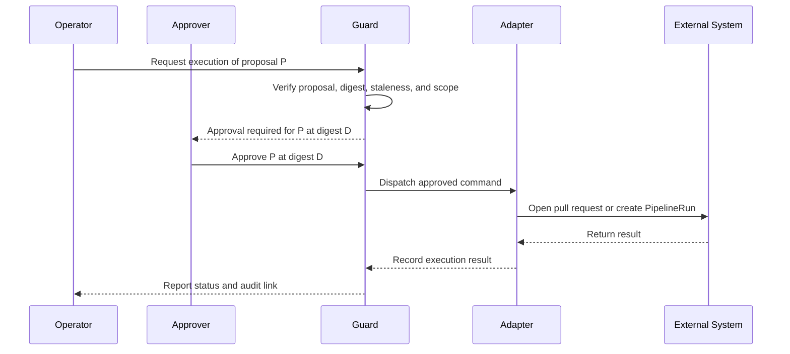
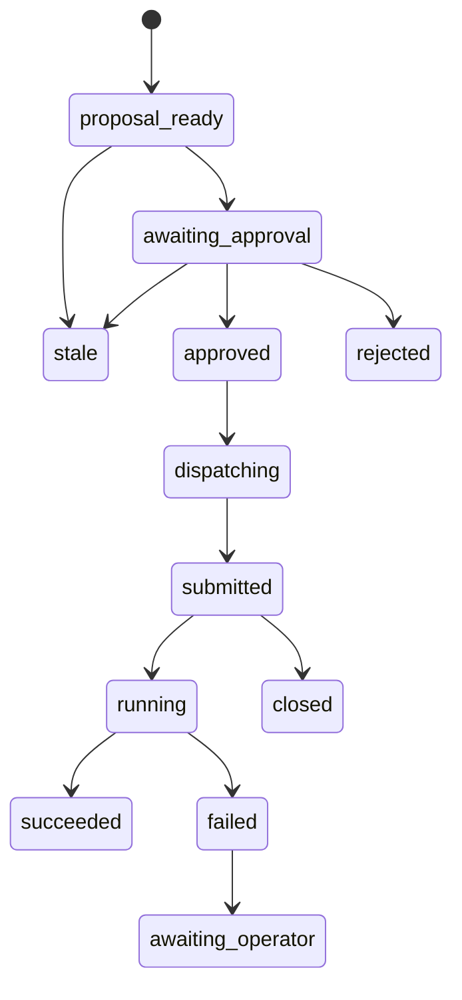

# Phase 3: Approved Execution

## Status

Draft, aligned on 2026-10-20 with the approved [Phase 2](05-phase-2-proposals.md) plan and its lifecycle facts. Implementation starts only after Phase 2 is complete and this plan is approved. Phases 0–2 were signed off on 2026-10-26; Phase 3 is bound by the [Phase 3 Entry Conditions](10-phase-0-2-closure.md#phase-3-entry-conditions).

## Objective

Execute narrowly scoped, human-approved Phase 2 proposals through guarded adapters.

Phase 3 is not autonomous operation. Every execution requires an explicit approval of one unchanged proposal.

## Execution Scope

Merging a `fleet-clusters` change is itself the trigger for Tekton, so Phase 3 executes each proposal type through exactly one path:

| Proposal type | Adapter | Side effect |
| --- | --- | --- |
| `scaffold` | Git | Pull request that adds `provision/<id>/**`; merging starts pre-provision, provision, and post-provision |
| `deprovision` | Git | Pull request whose only commit adds `deprovision/<id>-archive`; merging starts deprovision, then the archive Action |
| `cluster_edit` | Git | Pull request with the required commit message; merging starts nothing when `[skip-provision]` is preserved |
| `post_provision_rerun` | Tekton | PipelineRun created through the Kubernetes API in `openshift-pipelines` |

Phase 3 also monitors each execution and records its result.

Deferred actions:

1. Merging pull requests. A human merges.
2. Pushing to `main` or any protected branch.
3. Creating pre-provision, provision, or deprovision PipelineRuns directly.
4. Using the fleet EventListener; its post-provision trigger accepts unauthenticated requests.
5. Retrying automatically.
6. Deprovisioning without human approval.
7. Modifying protected repository code.
8. Writing Portal's database.
9. Bypassing the Command Guard.

## Approval Flow

## Guard Requirements

Before dispatch, the guard must verify:

1. The proposal record is `awaiting_approval`, and an approval record names its `proposal_id` and `proposal_digest`.
2. The requester is authorized for the execute command type.
3. The approver holds `approver` or `admin`, and is not the requester unless an emergency policy allows it.
4. `proposal_digest` still matches the stored proposal.
5. The proposal is not stale: `fleet-clusters` `HEAD` has not changed the target cluster since `base_commit`, and live evidence still meets the proposal's preconditions.
6. The proposal touches exactly one cluster.
7. Git proposals carry their required commit message; deprovision proposals add only `deprovision/<id>-archive`.
8. The idempotency key has not reached a terminal state.
9. The adapter is allow-listed for the proposal type.
10. The required external system is reachable.

If any check fails, execution is rejected and recorded.

## Git Adapter

The Git adapter may:

- Create a branch in a fork or in `fleet-clusters` when operational branches are allowed.
- Apply the reviewed patch to `base_commit`.
- Create exactly one commit per proposal, with the proposal's commit message.
- Push that branch and open a pull request whose description includes the trigger effect, reversibility, and required merge method.

The Git adapter must not:

- Push to `main` or any protected branch.
- Merge a pull request.
- Combine proposals or clusters in one commit or pull request.
- Modify files outside the proposal's paths.
- Include secret values.
- Force push.

Merge method matters because the EventListener reads only the push head commit:

| Proposal | Required merge method |
| --- | --- |
| `cluster_edit` that adds a file | Rebase or squash, keeping `[skip-provision]` in the resulting head commit message. A merge commit loses the marker and re-provisions the cluster. |
| `deprovision` | Rebase or squash, so the standalone sentinel commit is the only change in the push |
| `scaffold` | Any method, as long as the push contains no other cluster |

If `fleet-clusters` must remain completely unchanged, the adapter stops at the Phase 2 patch and returns it to the operator.

## Tekton Adapter

The Tekton adapter may:

- Create an approved post-provision PipelineRun in `openshift-pipelines` through the Kubernetes API.
- Poll PipelineRun status.
- Fetch non-secret task logs.
- Record success or failure.

The Tekton adapter must not:

- Create PipelineRuns for pre-provision, provision, or deprovision.
- Call the fleet EventListener.
- Create or modify Pipeline definitions in `fleet`.
- Treat the model as the workflow engine.
- Retry automatically.

## Credentials

| Adapter | Credential | Allowed actions |
| --- | --- | --- |
| Git | Repository token or deploy key scoped to branch push and pull request creation | Push non-protected branches, open pull requests |
| Tekton | Dedicated ServiceAccount, separate from `aura-readonly` | `create`, `get`, and `list` on `pipelineruns.tekton.dev` in `openshift-pipelines` |

Neither credential is visible to the read-only collectors or to CWA.

## Execution States

Proposal records carry these states; the originating command record stays immutable once terminal.

`submitted` means a pull request is open or a PipelineRun was created. `closed` means a pull request was closed without merging. A failed execution never retries automatically; a new attempt requires a new proposal or approval.

## Audit Record

Every execution records:

- Command ID and proposal ID.
- `proposal_digest`, `base_commit`, and evidence snapshot digest.
- CWA trace ID.
- Requester and approver identities.
- Approval time.
- Adapter name and version.
- Input parameters, redacted.
- External result: pull request URL and commit SHA, or PipelineRun name and UID.
- Trigger effect and reversibility.
- Failure reason, if any.
- Rollback instruction, or the statement that none exists.

## Acceptance Criteria

- A read-only command cannot be dispatched as an execution command.
- An unapproved proposal cannot execute.
- A modified or stale proposal cannot execute under an old approval.
- A duplicate idempotency key does not execute twice.
- A multi-cluster change is rejected.
- A deprovision execution produces one standalone commit that adds only `deprovision/<id>-archive`.
- A `cluster_edit` that adds a file always carries `[skip-provision]`, and its pull request states the required merge method.
- No adapter pushes to `main`, merges, or calls the EventListener.
- Git and Tekton adapters run with separate least-privilege credentials.
- Every execution produces an immutable audit event.
- A failed execution records enough information for manual recovery.
- Protected repository code remains unchanged.

## Open Questions

1. Should the Git adapter push to a fork or to operational branches in `fleet-clusters`? [Open Questions](08-open-questions.md#repository-boundaries) defaults to a full freeze, which stops Phase 3 at the patch.
2. Can branch protection enforce rebase or squash merges on `fleet-clusters`? If not, the merge-method rule depends on reviewers.
3. Who may approve deprovision, given that it is irreversible?
