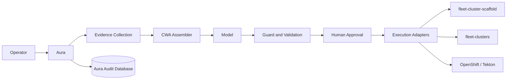

# Aura Planning Index

## Status

Draft for review. No implementation work has started.

## Objective

Build Aura as a clean, operator-facing control plane for OpenShift Partner Labs without modifying the four protected repositories:

- `fleet`
- `fleet-cluster-scaffold`
- `fleet-clusters`
- `portal`

Aura will help a human operator understand current state, diagnose problems, prepare changes, and eventually execute approved actions. It will not replace Tekton, Argo CD, ACM/Hive, Git, or OpenShift as the authority for cluster lifecycle.

## Decision Summary

| Decision | Position |
| --- | --- |
| Primary architecture | Sidecar control plane, not a replacement workflow engine |
| Existing queue system | Leave in place; do not require it for Aura |
| Cluster workflow engine | Continue using Tekton through `fleet` |
| Source of truth | Git for desired state, OpenShift for actual state, Aura only for commands and audit |
| Portal integration | Read-only or none; Aura does not write Portal's database |
| Model integration | Every model call is assembled through Context Window Architecture (CWA) |
| First release | Read-only diagnosis and inventory |
| Autonomous execution | Deferred until guarded, approved execution is proven |

## Plan Documents

| Document | Purpose |
| --- | --- |
| [Current State](01-current-state.md) | Constraints, pain points, and why a sidecar rebuild is justified |
| [Target Architecture](02-target-architecture.md) | Components, boundaries, state ownership, and CWA integration |
| [Phase 0: Baseline](03-phase-0-baseline.md) | Contracts, access, and evidence model before product work |
| [Phase 1: Read-Only Assistant](04-phase-1-read-only-assistant.md) | Inventory and diagnosis without side effects |
| [Phase 2: Proposals](05-phase-2-proposals.md) | Patch, pipeline, and action proposals without execution |
| [Phase 3: Approved Execution](06-phase-3-approved-execution.md) | Guarded execution after explicit human approval |
| [Testing, Security, and Rollout](07-testing-security-rollout.md) | Validation strategy and release gates |
| [Open Questions](08-open-questions.md) | Decisions needed before implementation |

## High-Level Flow

## Non-Negotiable Boundaries

1. Do not modify code in `fleet`, `fleet-cluster-scaffold`, `fleet-clusters`, or `portal`.
2. Do not write Portal's database.
3. Do not expose secrets to the model.
4. Do not let model output become authoritative state.
5. Do not execute a command without schema validation, policy validation, and explicit approval.
6. Do not replace Tekton as the cluster workflow engine.

